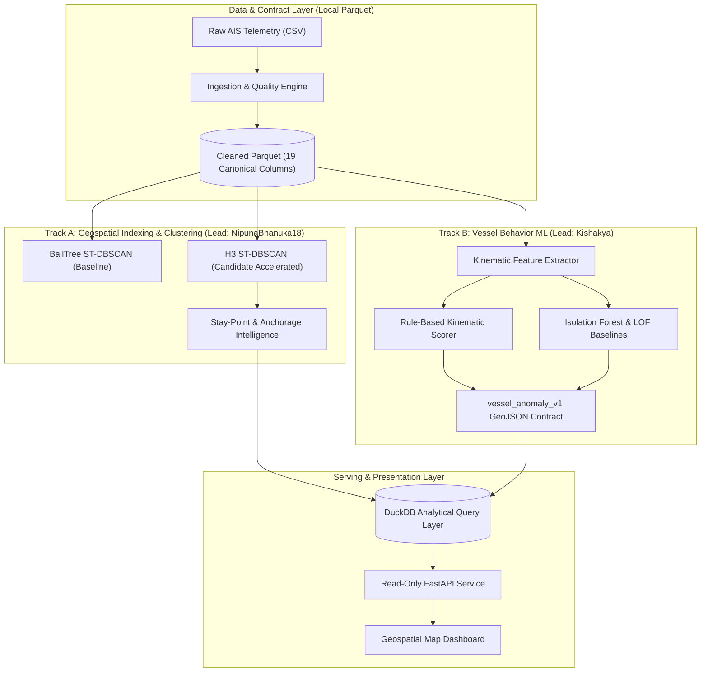
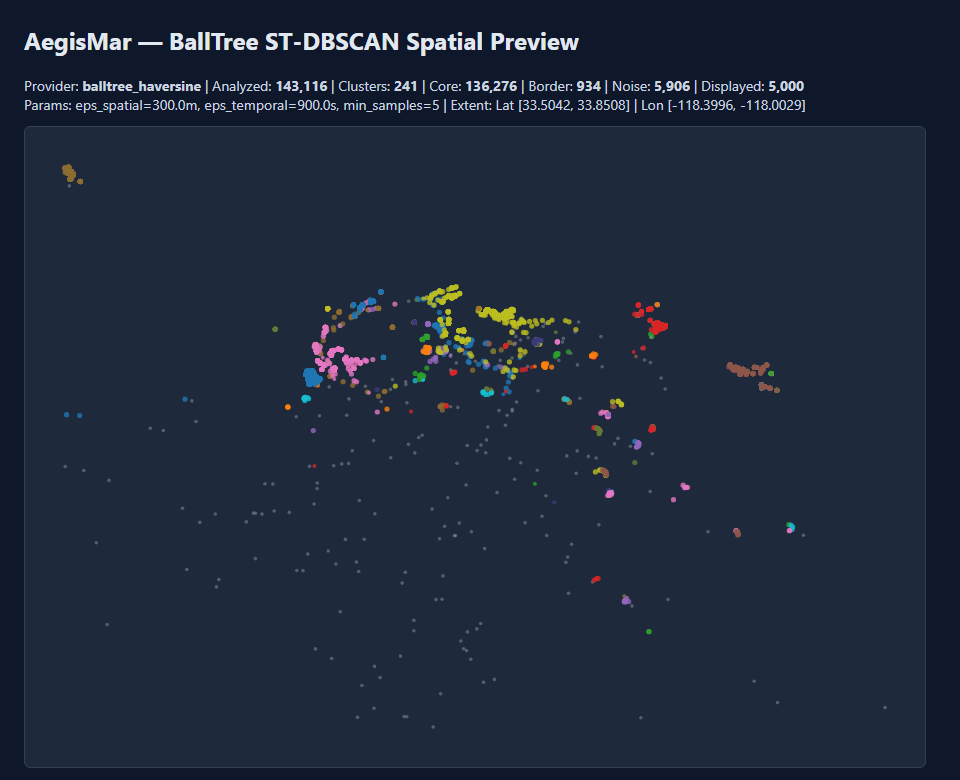

# Project AegisMar

> **Explainable Maritime Traffic Intelligence & Vessel Behavior Anomaly Detection Platform**

[](https://www.python.org/downloads/release/python-3119/)
[](#2-current-status-and-research-tracks)
[](#14-license-attribution)

> [!TIP]
> **New to Project AegisMar or reviewing for the first time?**  
> Read the **[START HERE Onboarding Guide](docs/START-HERE.md)** for a complete walkthrough of the real maritime problem, platform architecture, verified mathematical baselines, and quickstart reproduction instructions.

---

## 1. Project Overview

**Project AegisMar** is an undergraduate AI research and software engineering initiative designed to build a scientifically rigorous, reproducible maritime Automatic Identification System (AIS) analytics platform.

The platform operates as a collaborative, multi-engine modular monolith structured around two complementary research tracks:
1. **Clustering & Spatial Indexing Track (Track Lead: NipunaBhanuka18)**: Scalable spatiotemporal density clustering (ST-DBSCAN) comparing discrete hexagonal indexing (Uber H3) against a geodesic Haversine BallTree baseline, combined with vessel-aware stay-point and anchorage intelligence.
2. **Vessel Behavior Anomaly Detection Track (Track Lead: Kishakya)**: Trajectory-aware kinematic feature engineering and unsupervised anomaly detection (multi-factor kinematic scoring and Isolation Forest / LOF baselines) producing explainable physical justifications for alerts.

---

<a id="current-status"></a>
## 2. Current Status & Research Tracks

- **Phase**: **Week 3 complete (2026-11-28).**
  - Track A: W3-01 / W3-01A / W3-01B (H3), **W3-02A** (dataset provenance and fingerprinting) and **W3-02** (comparative H1 benchmark) are done.
  - Track B: **ML-01 to ML-04 merged** (ML-01 literature review pending).
  - Next: Week 4 stay-point extraction, berth exclusion and anchorage intelligence (Track A); ML-05 (Track B).
- **State**:
  - Validated AIS ingestion pipeline (`zstd` Parquet + manifest, logical content fingerprints).
  - Reference Haversine `BallTree` ST-DBSCAN (`stdbscan-core-first-v1.0`) and an independent $O(N^2)$ brute-force oracle.
  - Uber H3 candidate neighborhood provider (Option B correctness contract).
  - Track B trajectory feature extractor (ML-04).
  - **183 automated tests, 96% coverage**, enforced by GitHub Actions CI (ruff, ruff format, mypy, pytest with coverage ≥ 85%).
- **W3-02 result (single host, descriptive)**:
  - H3 matches BallTree exactly at every scale.
  - H3 r8 is slower below 100k, at parity at 100k, and **1.15× faster at full scale** (143,116 rows).
  - See [W3-02 Benchmark Results](docs/03-research/w3-02-benchmark-results.md).
- **Codebase Implementation**: Pre-alpha (`0.1.0.dev1`).
- **Research Tracks**:
  - **Track A (Clustering & Platform Lead: NipunaBhanuka18)**: Stay-point extraction, berth exclusion and anchorage analytics (Week 4).
  - **Track B (ML Anomaly Detection Lead: Kishakya)**: Trajectory feature engineering and ML behavior anomaly detection (independent track; see [ML Research Proposal](docs/03-research/vessel-behavior-ml.md), [ML-02 Feature Specification](docs/03-research/ml-02-feature-spec.md), [ML-03 Evaluation Protocol](docs/03-research/ml-03-evaluation-protocol.md) and [Collaborator Onboarding Guide](docs/05-guides/ml-research-onboarding.md)).
  - Shared analytical storage (DuckDB), read-only FastAPI service, and geospatial map dashboard planned for Weeks 6–7.

---

## 3. Maritime Problem Statement

Maritime domain awareness (MDA) relies heavily on global AIS transponder broadcasts. However, real-world AIS data poses severe analytical bottlenecks:
1. **High Volume & Velocity**: Billions of spatial pings overwhelm naive quadratic spatial algorithms.
2. **Data Quality Flaws**: Pervasive missing records, dead-reckoning nulls, GPS drift, and sentinel values (e.g., SOG 102.3 kt, heading 511°, status 15).
3. **Density Noise vs. Malicious Anomalies**: Vessels lingering in holding areas or drifting with tidal currents generate dense clusters that naive detectors misclassify as anomalous, while actual kinematic deviations (e.g., sudden dark transponder gaps, abnormal loitering outside designated anchorages) are obscured.
4. **Lack of Explainability**: Maritime decision-support literature highlights that opaque "black box" anomaly scores risk operator alert fatigue; effective intervention requires transparent, physical justifications for alerts.

---

## 4. Research Objectives

### Primary Research Objective (RQ1)
Investigate the measured runtime, query latency, and memory performance of an **H3-accelerated Spatiotemporal DBSCAN (ST-DBSCAN)** candidate-generation engine compared against a reference **Haversine BallTree** baseline. The objective requires verifying whether discrete hexagonal partitioning achieves measurable indexing and query efficiency while guaranteeing 100% eligible-neighbor recall on defined correctness tests.

The W3-02 benchmark found exact parity at all tested scales. On a single host and dataset, it measured a scale-dependent speedup for H3 r8 (1.15× at full scale, slower below 100k). Generalization beyond this host, dataset and parameter set remains untested.

### Secondary Research Objective (RQ2)
Evaluate whether a **lightweight, trajectory-aware rule-based scoring engine** (augmented conditionally with Isolation Forest) can reliably surface kinematic anomalies (drift, loitering, speed discontinuities) with significantly lower false-positive rates than point-density outlier baselines.

---

## 5. Planned MVP Features

- **Validated AIS Ingestion**: Deterministic Parquet-based ingestion with explicit sentinel masking, coordinate bounds validation, and chronological trajectory sorting.
- **Dual Spatiotemporal Clustering Engines**:
  - *Baseline*: `scikit-learn` BallTree utilizing exact haversine metric.
  - *Candidate-Accelerated*: Uber H3 discrete global grid index with correctness-preserving neighbor expansion.
- **Vessel-Aware Anchorage Analytics**: Stay-point extraction, port berth exclusion, and true unique-vessel dwell tracking (distinguishing vessel count from raw ping density).
- **Explainable Anomaly Scoring**: Multi-factor kinematic scoring (speed jump, turn-rate anomalies, dark transponder gaps, anchorage boundary violations).
- **Read-Only API & Map Inspector**: Lightweight FastAPI service delivering precomputed GeoJSON layers to an interactive Leaflet/MapLibre browser dashboard.

---

## 6. High-Level Architecture

AegisMar is designed as a **Python-first modular monolith** prioritizing scientific correctness, local execution, and reproducibility without distributed systems overhead. The platform decouples data engineering, spatial clustering, and trajectory anomaly detection across modular boundaries:



---

## 7. Technology Stack

| Component | Current Status | Planned Technology | Selection Justification |
|---|---|---|---|
| **Runtime** | Python 3.11.9 | Python 3.11.9 | Binary wheel compatibility on Windows for C-extensions (`h3`, `scikit-learn`). |
| **Package Manager**| `uv` (0.11.x) | `uv` | High performance, reproducible dependency locking (`uv.lock`), PEP 621 compliant. |
| **Build Backend** | `hatchling` | `hatchling` | Standard, modern PEP 517 build backend. |
| **Quality Gates** | `ruff`, `mypy`, `pytest` | `ruff`, `mypy`, `pytest` | Sub-second linting/formatting, strict static typing, rigorous unit testing. |
| **Data Engine** | Implemented (`pyarrow`); `duckdb` planned (W6) | `duckdb`, `pyarrow` | Columnar Parquet I/O (`zstd`) implemented via PyArrow; in-process DuckDB planned for W6. |
| **Spatial Indexing**| Implemented: BallTree (W2-01) & H3 (W3-01B) | `numpy`, `scikit-learn`, `h3` (4.x) | Haversine `BallTree` reference engine and empirical H3 hexagonal candidate provider (calibrated Res 7–9) with fail-closed fallback; bit-for-bit graph parity verified on authentic NOAA AIS. |
| **Web Service** | *Planned (W6)* | `fastapi`, `uvicorn` | Lightweight, asynchronous, typed, read-only HTTP endpoints serving GeoJSON. |
| **Geospatial UI** | *Planned (W7)* | Vanilla JS + Leaflet / MapLibre | Zero-build-step interactive geospatial visualization. |

---

## 8. Development Roadmap & Dual-Track Architecture

The project is structured across two complementary, decoupled research tracks:

### Track A: Maritime Traffic & Platform Foundation (Lead: NipunaBhanuka18)
Estimated 200 hours (25 h/week) across an 8-week engineering baseline:
- **Week 1**: Repository initialization, doc tree, AIS data ingestion, and sentinel masking.
- **Week 2**: Ingestion hardening, Haversine `BallTree` reference ST-DBSCAN, and independent brute-force oracle verification.
- **Week 3**: Uber H3 candidate optimization, boundary/pentagon completeness testing, and comparative H1 benchmarks.
- **Week 4**: Vessel-aware stay-point extraction and anchorage dwell analysis (with berth exclusion).
- **Week 5**: Analytical storage integration (DuckDB/Parquet) and ML anomaly contract ingestion.
- **Week 6**: Read-only FastAPI service implementation serving precomputed clusters, anchorages, and anomalies.
- **Week 7**: Geospatial dashboard implementation and end-to-end analytical validation.
- **Week 8**: Performance benchmarking, reproducibility report, and research paper completion.

### Track B: Vessel Behavior ML & Anomaly Detection (Lead: Kishakya)
Independent parallel research track with its own flexible milestone backlog (`ML-01` to `ML-05`):
- Trajectory kinematic feature engineering, rule-based explainability scoring, unsupervised Isolation Forest/LOF baselines, and `vessel_anomaly_v1` GeoJSON contract export. Operates on an independent schedule decoupled from Track A's critical path.

---

## 9. Current Milestones & Progress

### Track A Milestones (Platform & Clustering — NipunaBhanuka18)

| Milestone | Title | Target Week | Status |
|---|---|---|---|
| **W1-01** | Repository Initialization & Documentation Foundation | Week 1 | **Completed** |
| **W1-02A**| NOAA AIS Dataset Selection & Schema Investigation | Week 1 | **Completed** |
| **W1-02B**| AIS Ingestion, Data Quality & Parquet Storage | Week 1 | **Completed** |
| **W2-01** | Ingestion Corrections, BallTree ST-DBSCAN & Brute-Force Oracle | Week 2 | **Completed** |
| **DOC-01** | Evidence-Backed Research & Engineering Documentation | Week 2+ | **Completed** |
| **DOC-01A**| Research Documentation Accuracy & Collaborator Readiness | Week 2+ | **Completed** |
| **W3-01** | H3 Candidate Optimization & Completeness Verification | Week 3 | **Completed** |
| **W3-01A**| H3 Completeness Audit, Correctness Hardening & PR Prep | Week 3 | **Completed** |
| **W3-01B**| H3 Correctness Contract Finalization | Week 3 | **Completed** |
| **W3-02A**| Dataset Provenance & Deterministic Fingerprinting | Week 3 | **Completed** |
| **W3-02** | Comparative H1 Benchmarking (BallTree vs. H3) | Week 3 | **Completed** ([results](docs/03-research/w3-02-benchmark-results.md)) |
| **W4-01** | Stay-Point Extraction & Anchorage Dwell Identification | Week 4 | Planned |
| **W4-02** | Anchorage Basin Dwell & Utilization Analytics | Week 4 | Planned |
| **W5-01** | DuckDB In-Process Analytics & Contract Integration | Week 5 | Planned |
| **W6-01** | Read-Only FastAPI Service Implementation | Week 6 | Planned |
| **W7-01** | Geospatial Incident Dashboard & End-to-End Demo | Week 7 | Planned |
| **W8-01** | Benchmark Execution, Reproducibility & Research Report | Week 8 | Planned |

### Track B Milestones (Behavioral ML & Anomaly Detection — Kishakya)

| Milestone | Title | Target Phase | Status |
|---|---|---|---|
| **ML-01** | Domain Literature, AIS Schema & Telemetry Review | Phase 1 | **In Progress** (data profiling completed; literature review pending) |
| **ML-02** | Vessel Trajectory Kinematic Feature Specification | Phase 2 | **Completed** ([v1.0](docs/03-research/ml-02-feature-spec.md)) |
| **ML-03** | Baseline Models & Evaluation Protocol Freezing | Phase 3 | **Completed** ([v1.0](docs/03-research/ml-03-evaluation-protocol.md)) |
| **ML-04** | Feature Engineering Module & Baseline Experiments | Phase 4 | **Completed** (PR #6) |
| **ML-05** | Anomaly Model Evaluation & `vessel_anomaly_v1` Export | Phase 5 | Planned |

### Week 2 Reference Clustering Baseline & Exploratory Visualization



> **Figure 1 — Exploratory BallTree ST-DBSCAN Spatial Preview (Pre-Week 3 Research Baseline)**  
> - **Region:** Los Angeles / Long Beach (San Pedro Bay, Lat `[33.5042, 33.8508]`, Lon `[-118.3996, -118.0029]`)  
> - **Data:** Historical NOAA AIS observations from January 1, 2025 (`143,124` canonical pings; `8` `TIMESTAMP_POSITION_CONFLICT` rows excluded by policy -> `143,116` analyzed; `5,000` points rendered in preview)  
> - **Method:** Reference Haversine `BallTree` ST-DBSCAN (`stdbscan-core-first-v1.0`, verified 100% against an independent brute-force oracle on synthetic fixtures and a 1,000-row real LA/LB subset)  
> - **Parameters:** `300 m` spatial radius, `900 s` temporal window, `MinPts 5` (illustrative exploratory configuration)  
> - **Status:** Exploratory clustering, not validated anchorage identification. The `241` discovered spatiotemporal density clusters (`136,276` core, `934` border, `5,906` noise) span berthed/moored vessels, inner harbor basins, offshore holding areas, and dense coastal traffic; formal stay-point extraction and berth polygon exclusion are scheduled for Week 4.

**Recorded Pre-Week 3 Reference Baseline (`balltree_haversine`, commit `3ece859`):**
- **Uninstrumented wall time (`143,116` analyzed rows):** `13.680 s` total (`0.077 s` BallTree build, `13.341 s` batched radius query + exact Haversine/temporal pruning, `0.262 s` deterministic core-first clustering).
- **Instrumented memory check (`tracemalloc`):** `38.014 s` total wall time, `225.83 MB` peak Python heap.
- **Follow-up:** The Uber H3 candidate provider (`H3NeighborhoodProvider`) has since been implemented and verified (W3-01 / W3-01B). It has also been formally benchmarked against BallTree in W3-02: 10 counterbalanced trials per scale give an official BallTree full-scale total of 12.4074 s, against 10.7867 s for H3 r8. See [W3-02 Benchmark Results](docs/03-research/w3-02-benchmark-results.md).

---

## 10. Environment Setup & CLI Usage

### Prerequisites
- Windows 10/11 (or Linux/macOS)
- Git (>= 2.40)
- Python 3.11.9
- `uv` (>= 0.11.0)

### Quickstart Setup
```powershell
# Clone repository
git clone https://github.com/NipunaBhanuka18/Project-AegisMar.git
cd "Project-AegisMar"

# Synchronize virtual environment with locked dependencies
uv sync --locked

# Run test suite and static quality gates (same gates as GitHub Actions CI)
uv run pytest --cov=aegismar --cov-report=term-missing --cov-fail-under=85 -v
uv run ruff check .
uv run ruff format --check .
uv run mypy src tests
```

### AIS Data Ingestion & Reference Clustering CLI
The canonical dataset is v1.1 (`data/processed/lalb_20250101_v1_1/`). Both v1.0 (`lalb_20250101/`) and v1.1 are **immutable**: never pass `--overwrite` to `ingest` for them. Without `--overwrite`, ingestion refuses to replace an existing Parquet or manifest.

```powershell
# Reproduce the canonical v1.1 Parquet from the regional sample (in-memory batch pipeline; 50 kt implied-speed threshold is the default)
uv run python -m aegismar ingest --input data/raw/sample_lalb_20250101.csv --output data/processed/lalb_20250101_v1_1

# Verify file SHA-256 and logical fingerprint (read-only; expect bdde2581... / d8a619f7...)
uv run python -m aegismar fingerprint --input data/processed/lalb_20250101_v1_1/cleaned_ais.parquet

# Run reference Haversine BallTree ST-DBSCAN (--overwrite here only replaces git-ignored experiment outputs)
uv run python -m aegismar cluster --input data/processed/lalb_20250101_v1_1/cleaned_ais.parquet --output experiments/outputs/w2_01_lalb_balltree --eps-spatial-m 300 --eps-temporal-s 900 --min-samples 5 --overwrite

# Run verified H3-accelerated ST-DBSCAN
uv run python -m aegismar cluster --input data/processed/lalb_20250101_v1_1/cleaned_ais.parquet --output experiments/outputs/w3_01_lalb_h3 --provider h3 --h3-resolution 8 --eps-spatial-m 300 --eps-temporal-s 900 --min-samples 5 --overwrite

# Verify bit-for-bit graph and clustering parity between BallTree and H3
uv run python -m aegismar verify-parity --input data/processed/lalb_20250101_v1_1/cleaned_ais.parquet --eps-spatial-m 300 --eps-temporal-s 900 --min-samples 5 --h3-resolution 8

# Run the full W3-02 benchmark (about 38 min on the reference host; see docs/03-research/w3-02-benchmark-results.md)
uv run python experiments/clustering/w3_02_benchmark.py -i data/processed/lalb_20250101_v1_1/cleaned_ais.parquet -o experiments/outputs/w3_02_benchmark_results.json
```

---

## 11. Research Methodology Overview

1. **Independent Verification Oracle**: A brute-force $O(N^2)$ geodesic distance comparator serves as the ground-truth test oracle in automated unit testing.
2. **Correctness Contract (Option B)**: H3 candidate neighbor sets operate under an empirical correctness contract backed by conservative clearance tables on calibrated resolutions (7, 8, 9) and fail-closed BallTree fallback, verified bit-for-bit against the BallTree reference on the San Pedro Bay research sector ($\text{Recall} = 1.0$). Uncalibrated resolutions require explicit experimental opt-in.
3. **Vessel-Aware Metrics**: Anchorage utilization and dwell times are computed per unique vessel (`MMSI`), avoiding raw ping density bias.
4. **Leakage-Free Anomaly Evaluation**: Trajectory anomaly detectors are fitted and tuned on a vessel-disjoint split of a development day (2025-01-01) and evaluated once on two separate held-out days (2025-01-14, 2025-01-22) with documented synthetic perturbations, per the frozen [ML-03 protocol](docs/03-research/ml-03-evaluation-protocol.md).

---

## 12. Documentation Index

The repository maintains comprehensive, verified technical documentation:

- **Executive & Onboarding Guides**:
  - **[START HERE Onboarding Guide](docs/START-HERE.md)** *(Start here for architecture, evidence, and reproduction)*
  - [ML Research Collaborator Onboarding Guide](docs/05-guides/ml-research-onboarding.md)
  - [Installation & Environment Setup Guide](docs/05-guides/installation.md)
  - [Contributing Guidelines & Quality Standards](CONTRIBUTING.md)
- **Project Definition & Governance**:
  - [Project Vision](docs/01-project/vision.md)
  - [Business Requirements Specification (BRS Draft v2.1)](docs/01-project/brs.md)
  - [Software Requirements Specification (SRS Draft v2.1)](docs/01-project/srs.md)
  - [Scope & Boundary Definition](docs/01-project/scope.md)
  - [Eight-Week Roadmap](docs/01-project/roadmap.md)
  - [Collaborative Research & Engineering Plan](docs/01-project/collaboration-plan.md)
- **Architecture & Technical Decisions**:
  - [System Architecture](docs/02-architecture/system-architecture.md)
  - [Architecture Decision Register (ADRs 001–011)](docs/02-architecture/decisions/README.md)
- **Research, Evidence & Evaluation**:
  - [Research Evidence Register](docs/03-research/evidence-register.md) *(Claims verification matrix)*
  - [Research Plan & Hypotheses](docs/03-research/research-plan.md)
  - [ML Research Proposal: Vessel Behavior Anomaly Detection](docs/03-research/vessel-behavior-ml.md)
  - [ML-02 Vessel Trajectory Feature Specification (v1.0)](docs/03-research/ml-02-feature-spec.md)
  - [ML-03 Track B Evaluation Protocol (v1.0)](docs/03-research/ml-03-evaluation-protocol.md)
  - [Scientific Evaluation Protocol](docs/03-research/evaluation-protocol.md)
  - [W3-02 Benchmark Protocol](docs/03-research/w3-02-benchmark-protocol.md) and [W3-02 Benchmark Results](docs/03-research/w3-02-benchmark-results.md)
  - [Dataset Management & Quality Protocol](docs/03-research/datasets.md)
- **Development & Verification**:
  - [Milestone Schedule & Tracking](docs/04-development/milestones.md)
  - [Development Log](docs/04-development/development-log.md)
  - [Testing & Quality Assurance Strategy](docs/04-development/testing-strategy.md)
- **Release History**:
  - [Project Changelog](CHANGELOG.md)

---

## 13. Scope Exclusions & Known Limitations

To ensure successful delivery within the 8-week developer capacity, the following features are strictly out-of-scope for the MVP:
- **No Real-Time Streaming or Replay**: Real-time NMEA stream ingestion or playback servers are excluded.
- **No Complex Distributed Infrastructure**: No PostgreSQL/PostGIS, Apache Kafka, Kubernetes, or microservices.
- **No Authentication / Authorization**: The MVP is designed strictly as a localhost single-user tool.
- **No Unverifiable Dark-Vessel Guarantees**: AIS signal gaps are flagged as reception or transponder gaps; no unverified claims of intentional deactivation, hostile intent, or sanction evasion will be made.

---

<a id="license-and-attribution"></a>
## 14. License & Attribution

- **License**: Pending formal selection. All rights currently reserved.
- **Research Team & Track Leadership**:
  - **Project Lead & Geospatial Clustering Track**: NipunaBhanuka18
  - **ML Research Collaborator & Vessel Behavior ML Track Lead**: Kishakya
- **Academic Context**: Undergraduate AI Research & Software Engineering Capstone Collaboration.

