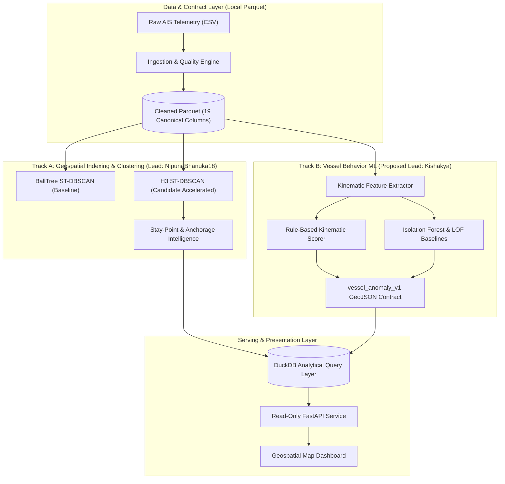

# Project AegisMar

> **Explainable Maritime Traffic Intelligence & Vessel Behavior Anomaly Detection Platform**

[](https://www.python.org/downloads/release/python-3119/)
[](#2-current-status)
[](#14-license-attribution)

---

## 1. Project Overview

**Project AegisMar** is an undergraduate AI research and software engineering initiative designed to build a scientifically rigorous, reproducible maritime Automatic Identification System (AIS) analytics platform.

The platform operates as a collaborative, multi-engine modular monolith structured around two complementary research tracks:
1. **Clustering & Spatial Indexing Track (Track Lead: NipunaBhanuka18)**: Scalable spatiotemporal density clustering (ST-DBSCAN) comparing discrete hexagonal indexing (Uber H3) against a geodesic Haversine BallTree baseline, combined with vessel-aware stay-point and anchorage intelligence.
2. **Vessel Behavior Anomaly Detection Track (Proposed Track Lead: Kishakya, *pending review*)**: Trajectory-aware kinematic feature engineering and unsupervised anomaly detection (multi-factor kinematic scoring and Isolation Forest / LOF baselines) producing explainable physical justifications for alerts.

---

<a id="current-status"></a>
## 2. Current Status & Research Tracks

- **Phase**: Milestone **W2-01 & W2-CLOSE (Completed)**; Collaboration Foundation established.
- **State**: Validated in-memory AIS ingestion pipeline (`zstd` Parquet + manifest), hardened MMSI/conflict/schema checks, reference Haversine `BallTree` ST-DBSCAN (`stdbscan-core-first-v1.0`), independent $O(N^2)$ brute-force oracle, and exploratory LA/LB baseline completed and verified (52 unit/oracle tests, 95% coverage).
- **Codebase Implementation**: Pre-alpha (`0.1.0.dev1`).
- **Research Tracks**:
  - **Track A (Clustering & Platform Lead: NipunaBhanuka18)**: Uber H3 candidate optimization, comparative H1 benchmarks, and stay-point/anchorage analytics (Weeks 3–4).
  - **Track B (ML Anomaly Detection: Kishakya, *proposed*)**: Trajectory feature engineering and ML behavior anomaly detection (independent track; see [ML Research Proposal](docs/03-research/vessel-behavior-ml.md) and [Collaborator Onboarding Guide](docs/05-guides/ml-research-onboarding.md)).
  - Shared analytical storage (DuckDB), read-only FastAPI service, and geospatial map dashboard planned for Weeks 6–7.

---

## 3. Maritime Problem Statement

Maritime domain awareness (MDA) relies heavily on global AIS transponder broadcasts. However, real-world AIS data poses severe analytical bottlenecks:
1. **High Volume & Velocity**: Billions of spatial pings overwhelm naive quadratic spatial algorithms.
2. **Data Quality Flaws**: Pervasive missing records, dead-reckoning nulls, GPS drift, and sentinel values (e.g., SOG 102.3 kt, heading 511°, status 15).
3. **Density Noise vs. Malicious Anomalies**: Vessels lingering in holding areas or drifting with tidal currents generate dense clusters that naive detectors misclassify as anomalous, while actual kinematic deviations (e.g., sudden dark transponder gaps, abnormal loitering outside designated anchorages) are obscured.
4. **Lack of Explainability**: "Black box" anomaly detection fails maritime operators who require transparent, physical justifications for alerts.

---

## 4. Research Objectives

### Primary Research Objective (RQ1)
Investigate the measured runtime, query latency, and memory performance of an **H3-accelerated Spatiotemporal DBSCAN (ST-DBSCAN)** candidate-generation engine compared against a reference **Haversine BallTree** baseline. The objective requires verifying whether discrete hexagonal partitioning achieves measurable indexing and query efficiency while guaranteeing 100% eligible-neighbor recall on defined correctness tests (acknowledging that this performance and full correctness guarantee have not yet been empirically achieved and remain subject to experimental validation).

### Secondary Research Objective (RQ2)
Evaluate whether a **lightweight, trajectory-aware rule-based scoring engine** (augmented conditionally with Isolation Forest) can reliably surface kinematic anomalies (drift, loitering, speed discontinuities) with significantly lower false-positive rates than point-density outlier baselines.

---

## 5. Planned MVP Features

- **Validated AIS Ingestion**: Deterministic Parquet-based ingestion with explicit sentinel masking, coordinate bounds validation, and chronological trajectory sorting.
- **Dual Spatiotemporal Clustering Engines**:
  - *Baseline*: `scikit-learn` BallTree utilizing exact haversine metric.
  - *Candidate-Accelerated*: Uber H3 discrete global grid index with correctness-preserving neighbor expansion.
- **Vessel-Aware Anchorage Analytics**: Stay-point extraction, port berth exclusion, and true unique-vessel dwell tracking (distinguishing vessel count from raw ping density).
- **Explainable Anomaly Scoring**: Multi-factor kinematic scoring (speed jump, turn-rate anomalies, dark transponder gaps, anchorage boundary violations).
- **Read-Only API & Map Inspector**: Lightweight FastAPI service delivering precomputed GeoJSON layers to an interactive Leaflet/MapLibre browser dashboard.

---

## 6. High-Level Architecture

AegisMar is designed as a **Python-first modular monolith** prioritizing scientific correctness, local execution, and reproducibility without distributed systems overhead. The platform decouples data engineering, spatial clustering, and trajectory anomaly detection across modular boundaries:



---

## 7. Technology Stack

| Component | Current Status | Planned Technology | Selection Justification |
|---|---|---|---|
| **Runtime** | Python 3.11.9 | Python 3.11.9 | Binary wheel compatibility on Windows for C-extensions (`h3`, `scikit-learn`). |
| **Package Manager**| `uv` (0.11.x) | `uv` | High performance, reproducible dependency locking (`uv.lock`), PEP 621 compliant. |
| **Build Backend** | `hatchling` | `hatchling` | Standard, modern PEP 517 build backend. |
| **Quality Gates** | `ruff`, `mypy`, `pytest` | `ruff`, `mypy`, `pytest` | Sub-second linting/formatting, strict static typing, rigorous unit testing. |
| **Data Engine** | Implemented (`pyarrow`); `duckdb` planned (W6) | `duckdb`, `pyarrow` | Columnar Parquet I/O (`zstd`) implemented via PyArrow; in-process DuckDB planned for W6. |
| **Spatial Indexing**| BallTree Implemented (W2-01); H3 Planned (W3) | `numpy`, `scikit-learn`, `h3` (4.x) | Haversine `BallTree` reference baseline verified; Uber H3 deferred to Week 3. |
| **Web Service** | *Planned (W6)* | `fastapi`, `uvicorn` | Lightweight, asynchronous, typed, read-only HTTP endpoints serving GeoJSON. |
| **Geospatial UI** | *Planned (W7)* | Vanilla JS + Leaflet / MapLibre | Zero-build-step interactive geospatial visualization. |

---

## 8. Eight-Week Development Roadmap

The project is structured around an estimated 200 hours (25 h/week) across 8 milestone weeks:

- **Week 1**: Repository initialization, doc tree, AIS data ingestion, and sentinel masking.
- **Week 2**: Ingestion hardening, Haversine `BallTree` reference ST-DBSCAN, and independent brute-force oracle verification.
- **Week 3**: Uber H3 candidate optimization, boundary/pentagon completeness testing, and comparative H1 benchmarks.
- **Week 4**: Vessel-aware stay-point extraction and anchorage dwell analysis (with berth exclusion).
- **Week 5**: Trajectory anomaly detection engine (rule-based kinematics and optional Isolation Forest).
- **Week 6**: Analytical storage integration (DuckDB/Parquet) and read-only FastAPI service.
- **Week 7**: Geospatial dashboard implementation and end-to-end analytical validation.
- **Week 8**: Performance benchmarking, reproducibility report, and research paper completion.

---

## 9. Current Milestones & Progress

| Milestone | Title | Target Week | Status |
|---|---|---|---|
| **W1-01** | Repository Initialization & Documentation Foundation | Week 1 | **Completed** |
| **W1-02A**| NOAA AIS Dataset Selection & Schema Investigation | Week 1 | **Completed** |
| **W1-02B**| AIS Ingestion, Data Quality & Parquet Storage | Week 1 | **Completed** |
| **W2-01** | Ingestion Corrections, BallTree ST-DBSCAN & Brute-Force Oracle | Week 2 | **Completed** |
| **W3-01** | H3 Candidate Optimization & Completeness Verification | Week 3 | Planned |
| **W3-02** | Comparative H1 Benchmarking (BallTree vs. H3) | Week 3 | Planned |
| **W4-01** | Stay-Point Extraction & Anchorage Dwell Identification | Week 4 | Planned |
| **W5-01** | Kinematic Anomaly Scoring & Evaluation Engine | Week 5 | Planned |
| **W6-01** | DuckDB Analytical Query Layer & Read-Only API | Week 6 | Planned |
| **W7-01** | Geospatial Incident Dashboard & End-to-End Demo | Week 7 | Planned |
| **W8-01** | Benchmark Execution, Reproducibility & Research Report | Week 8 | Planned |

### Week 2 Reference Clustering Baseline & Exploratory Visualization


> **Figure 1 — Exploratory BallTree ST-DBSCAN Spatial Preview (Pre-Week 3 Research Baseline)**  
> - **Region:** Los Angeles / Long Beach (San Pedro Bay, Lat `[33.5042, 33.8508]`, Lon `[-118.3996, -118.0029]`)  
> - **Data:** Historical NOAA AIS observations from January 1, 2025 (`143,124` canonical pings; `8` `TIMESTAMP_POSITION_CONFLICT` rows excluded by policy -> `143,116` analyzed; `5,000` points rendered in preview)  
> - **Method:** Reference Haversine `BallTree` ST-DBSCAN (`stdbscan-core-first-v1.0`, verified 100% against an independent brute-force oracle on synthetic fixtures and a 1,000-row real LA/LB subset)  
> - **Parameters:** `300 m` spatial radius, `900 s` temporal window, `MinPts 5` (illustrative exploratory configuration)  
> - **Status:** Exploratory clustering, not validated anchorage identification. The `241` discovered spatiotemporal density clusters (`136,276` core, `934` border, `5,906` noise) span berthed/moored vessels, inner harbor basins, offshore holding areas, and dense coastal traffic; formal stay-point extraction and berth polygon exclusion are scheduled for Week 4.

**Recorded Pre-Week 3 Reference Baseline (`balltree_haversine`, commit `3ece859`):**
- **Uninstrumented wall time (`143,116` analyzed rows):** `13.680 s` total (`0.077 s` BallTree build, `13.341 s` batched radius query + exact Haversine/temporal pruning, `0.262 s` deterministic core-first clustering).
- **Instrumented memory check (`tracemalloc`):** `38.014 s` total wall time, `225.83 MB` peak Python heap.
- **Next research milestone (Week 3):** Implement correctness-preserving Uber H3 candidate indexing (`H3NeighborhoodProvider`) on the shared ST-DBSCAN core and run formal comparative H1 benchmarks against this BallTree baseline (H3 is not yet implemented).

---

## 10. Environment Setup & CLI Usage

### Prerequisites
- Windows 10/11 (or Linux/macOS)
- Git (>= 2.40)
- Python 3.11.9
- `uv` (>= 0.11.0)

### Quickstart Setup
```powershell
# Clone repository
git clone https://github.com/NipunaBhanuka18/Project-AegisMar.git
cd "Project-AegisMar"

# Synchronize virtual environment with locked dependencies
uv sync --locked

# Run test suite and static quality gates
uv run pytest -v
uv run pytest --cov=aegismar --cov-report=term-missing
uv run ruff check .
uv run ruff format --check .
uv run mypy src tests
```

### AIS Data Ingestion & Reference Clustering CLI
```powershell
# Ingest raw/regional AIS CSV into canonical Parquet storage (in-memory batch pipeline)
uv run python -m aegismar ingest --input data/raw/sample_lalb_20250101.csv --output data/processed/lalb_20250101

# Ingest with custom implied speed threshold (knots) and overwrite permission
uv run python -m aegismar ingest -i data/raw/sample_lalb_20250101.csv -o data/processed/lalb_20250101 -s 50.0 --overwrite

# Run reference Haversine BallTree ST-DBSCAN on cleaned AIS Parquet
uv run python -m aegismar cluster --input data/processed/lalb_20250101/cleaned_ais.parquet --output experiments/outputs/w2_01_lalb_balltree --eps-spatial-m 300 --eps-temporal-s 900 --min-samples 5 --overwrite
```

---

## 11. Research Methodology Overview

1. **Independent Verification Oracle**: A brute-force $O(N^2)$ geodesic distance comparator serves as the ground-truth test oracle in automated unit testing.
2. **Correctness Guarantee**: H3 candidate neighbor sets must prove zero false negatives against the BallTree reference ($\text{Recall} = 1.0$).
3. **Vessel-Aware Metrics**: Anchorage utilization and dwell times are computed per unique vessel (`MMSI`), avoiding raw ping density bias.
4. **Leakage-Free Anomaly Evaluation**: Trajectory anomaly detectors are evaluated using chronological and vessel-disjoint splits with physically plausible synthetic perturbations.

---

## 12. Documentation Index

The repository maintains comprehensive, verified technical documentation:

- **Project Definition & Requirements**:
  - [Project Vision](docs/01-project/vision.md)
  - [Business Requirements Specification (BRS Draft v2.1)](docs/01-project/brs.md)
  - [Software Requirements Specification (SRS Draft v2.1)](docs/01-project/srs.md)
  - [Scope & Boundary Definition](docs/01-project/scope.md)
  - [Eight-Week Roadmap](docs/01-project/roadmap.md)
  - [Collaborative Research & Engineering Plan](docs/01-project/collaboration-plan.md)
- **Architecture & Technical Decisions**:
  - [System Architecture](docs/02-architecture/system-architecture.md)
  - [ADR-001: Modular Monolith vs. Distributed Microservices](docs/02-architecture/decisions/ADR-001-modular-monolith.md)
- **Research & Evaluation**:
  - [Research Plan & Hypotheses](docs/03-research/research-plan.md)
  - [ML Research Proposal: Vessel Behavior Anomaly Detection](docs/03-research/vessel-behavior-ml.md)
  - [Scientific Evaluation Protocol](docs/03-research/evaluation-protocol.md)
  - [Dataset Management & Quality Protocol](docs/03-research/datasets.md)
- **Development & Verification**:
  - [Milestone Schedule & Tracking](docs/04-development/milestones.md)
  - [Development Log](docs/04-development/development-log.md)
  - [Testing & Quality Assurance Strategy](docs/04-development/testing-strategy.md)
- **Guides & Collaboration**:
  - [Contributing Guidelines & Quality Standards](CONTRIBUTING.md)
  - [ML Research Collaborator Onboarding Guide](docs/05-guides/ml-research-onboarding.md)
  - [Installation & Environment Setup Guide](docs/05-guides/installation.md)
- **Release History**:
  - [Project Changelog](CHANGELOG.md)

---

## 13. Scope Exclusions & Known Limitations

To ensure successful delivery within the 8-week developer capacity, the following features are strictly out-of-scope for the MVP:
- **No Real-Time Streaming or Replay**: Real-time NMEA stream ingestion or playback servers are excluded.
- **No Complex Distributed Infrastructure**: No PostgreSQL/PostGIS, Apache Kafka, Kubernetes, or microservices.
- **No Authentication / Authorization**: The MVP is designed strictly as a localhost single-user tool.
- **No Unverifiable Dark-Vessel Guarantees**: AIS signal gaps are flagged as kinematic/transponder gaps; no unverified claims of "hostile intent" or "sanction evasion" will be made.

---

<a id="license-and-attribution"></a>
## 14. License & Attribution

- **License**: Pending formal selection. All rights currently reserved.
- **Research Team & Track Leadership**:
  - **Project Lead & Geospatial Clustering Track**: NipunaBhanuka18
  - **Proposed ML Research Collaborator**: Kishakya *(participation, schedule, and attribution pending review)*
- **Academic Context**: Undergraduate AI Research & Software Engineering Capstone Collaboration.

