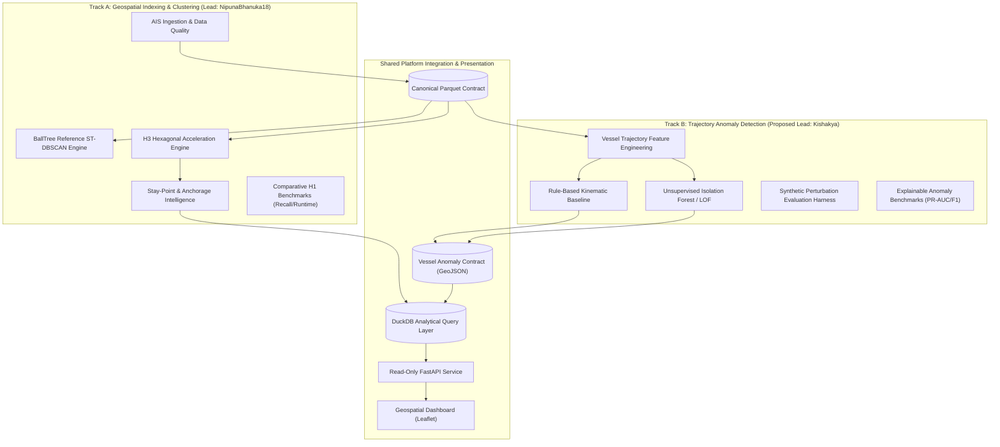

# Collaborative Research & Engineering Plan

> **Project AegisMar: Explainable Maritime Traffic Intelligence & Vessel Behavior Anomaly Detection Platform**  
> **Document Version:** 1.0  
> **Lifecycle Status:** Collaboration Agreement & Governance Baseline  
> **Researchers:**  
> - **NipunaBhanuka18**: Project Lead & Geospatial Clustering Researcher  
> - **Kishakya**: Proposed ML Research Collaborator *(participation, schedule, and attribution pending review)*  
> **Date:** 2026-11-22  

---

## 1. Collaboration Purpose and Context

Project AegisMar originated as an eight-week solo undergraduate research and software engineering capstone focused on spatiotemporal AIS clustering and explainable maritime intelligence. To accelerate both research depth and domain impact, the project is structured to support collaboration between two undergraduate AI researchers working on complementary, decoupled research tracks.

This plan establishes the operational boundaries, ownership domains, integration contracts, communication protocols, and academic credit principles governing the collaboration.

---

## 2. Research Tracks & Researcher Responsibilities

### Track A: Geospatial Indexing, Spatiotemporal Clustering & Anchorage Intelligence
- **Track Lead**: NipunaBhanuka18
- **Core Responsibilities**:
  - AIS data engineering pipeline (`aegismar.ingestion`) and Parquet storage management.
  - Geodesic spatial indexing foundation (`aegismar.spatial`) and independent test oracles (`oracle.py`).
  - Reference Haversine `BallTree` ST-DBSCAN clustering engine (`aegismar.clustering.balltree_neighbors`).
  - Uber H3 candidate generation optimization (`aegismar.clustering.h3_neighbors`) and H1 benchmarks.
  - Stay-point extraction and berth polygon exclusion (`aegismar.staypoint`).
  - Shared analytical storage (DuckDB) and read-only FastAPI service integration (`aegismar.api`).
  - Primary platform architecture maintenance and CI/CD quality enforcement.

### Track B: Vessel Trajectory Feature Engineering & Behavior Anomaly Detection
- **Proposed Track Lead**: Kishakya *(participation pending review)*
- **Core Responsibilities**:
  - Trajectory assembly and kinematic feature extraction (`aegismar.anomaly.features`).
  - Transparent rule-based kinematic anomaly scoring (`aegismar.anomaly.rules`).
  - Unsupervised machine learning models: Isolation Forest and alternative baselines (`aegismar.anomaly.models`).
  - Controlled synthetic perturbation generation and leakage-free evaluation harness (`aegismar.anomaly.evaluation`).
  - Explainable anomaly incident output generation adhering to the `vessel_anomaly_v1` GeoJSON contract.
  - Scientific analysis, error analysis, and research documentation for the ML track (`docs/03-research/vessel-behavior-ml.md`).

---

## 3. Scope Boundaries & Roadmap Independence

To ensure neither researcher blocks the other:
1. **Intact 8-Week Solo Roadmap**: NipunaBhanuka18's existing 8-week development roadmap (Weeks 1–8) for clustering, H3 optimization, and anchorage intelligence remains fully intact and self-sufficient.
2. **Independent ML Schedule**: Kishakya's ML research track operates on its own parallel schedule. Initial proposed tasks (ML-01 to ML-04) have no rigid deadlines and will be scheduled upon mutual agreement.
3. **No Mandatory Scope Creep**: The mandatory core deliverables of the AegisMar MVP remain protected. ML capabilities integrate through well-defined contracts without introducing hard dependencies into the clustering pipeline.
4. **Decoupled Module Namespaces**: Track A operates primarily in `aegismar.clustering`, `aegismar.spatial`, and `aegismar.staypoint`. Track B operates strictly within `aegismar.anomaly`.

---

## 4. Integration Contracts

Interoperability between the two tracks is governed by two versioned contracts:

### 4.1 Ingestion Contract (Input to ML Track)
- Source: `data/processed/<dataset_id>/cleaned_ais.parquet`
- Schema: 19 canonical fields defined in `src/aegismar/ingestion/schema.py`
- Guarantee: Sorted in canonical total order `(timestamp_utc, mmsi, latitude, longitude, source_row)`. Quality flags provided for each ping.

### 4.2 Anomaly Output Contract (Input to Serving Layer)
- Specification: `vessel_anomaly_v1` GeoJSON FeatureCollection
- Schema includes: `incident_id`, `mmsi`, `start_timestamp_utc`, `end_timestamp_utc`, `observation_source_rows`, `model_id`, `model_version`, `anomaly_score` $\in [0.0, 1.0]$, `score_semantics` (non-probabilistic index), `primary_factor`, `factor_contributions`, `data_quality_context`.
- Presentation: Ingested by the DuckDB query layer and served via `GET /api/v1/anomalies` without requiring runtime model execution.

---

## 5. Collaboration Workflows & Quality Standards

- **Branching**: All work happens on topic branches (`feat/ml-...`, `feat/clu-...`) branched off `main`.
- **Quality Gates**: Every pull request must pass all 5 gates (`pytest`, coverage $\ge 90\%$, `ruff check`, `ruff format`, strict `mypy`).
- **Data Protection**: Strict prohibition against committing raw AIS files, Parquet datasets, or local experiment outputs.
- **Review Policy**: Pull requests touching shared files (`pyproject.toml`, storage layer, API schemas) require mutual review and approval. Track-specific PRs are reviewed collaboratively.
- **Conflict Resolution**: Disagreements regarding platform architecture, dependencies, or shared schemas will be resolved through written design discussions referencing verifiable evidence and project requirements.

---

## 6. Academic Attribution & Authorship Principles

1. **Equal Intellectual Respect**: Both researchers are treated as primary academic contributors.
2. **Publication Co-Authorship**: Any research paper, conference submission, or technical thesis derived from Project AegisMar will include both researchers as co-authors, with lead authorship on specific papers reflecting track leadership (e.g., spatial clustering paper led by NipunaBhanuka18; anomaly detection paper led by Kishakya).
3. **Transparent Contribution Tracking**: Git commit histories, development logs, and milestone trackers will accurately document individual contributions.
4. **Prospective Status**: Kishakya's name is noted as the proposed collaborator. Her formal attribution and participation will be updated upon her review and acceptance of this plan.
