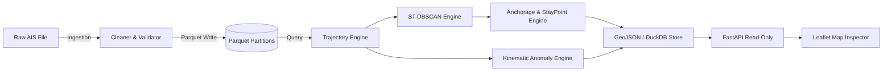

# Software Requirements Specification (SRS)

> **Project AegisMar: Explainable Maritime Traffic Intelligence & Vessel Behavior Anomaly Detection Platform**

**Document Version:** 2.1 (Draft)  
**Status:** Controlled Draft (Planning Baseline)  
**Author:** Solo AI Undergraduate Engineer  
**System Classification:** Python-first Modular Monolith  
**Target Environment:** Localhost / Single-Node Workstation  

---

## 1. Introduction

### 1.1 Purpose
This Software Requirements Specification (SRS) defines the concrete technical requirements, functional specifications, system interfaces, and constraints for the Project AegisMar MVP. It translates the high-level business requirements defined in the BRS into verifiable software engineering specifications.

### 1.2 System Scope
AegisMar is an offline, reproducible analytical engine for historical AIS data. It ingests tabular AIS telemetry, masks sentinels, constructs spatiotemporally coherent vessel trajectories, executes baseline and accelerated ST-DBSCAN clustering, identifies anchorage dwell areas with berth polygon exclusions, and computes explainable kinematic anomaly scores. Results are exported to Parquet and GeoJSON files, queried via DuckDB, and surfaced through a read-only FastAPI service and web map.

### 1.3 Definitions and Acronyms
- **AIS**: Automatic Identification System (ITU-R M.1371).
- **MMSI**: Maritime Mobile Service Identity (unique 9-digit vessel identifier).
- **SOG / COG**: Speed Over Ground (knots) / Course Over Ground (degrees).
- **HDG**: True Heading (degrees).
- **ST-DBSCAN**: Density-Based Spatial Clustering of Applications with Noise with temporal extension.
- **H3**: Uber's Hierarchical Hexagonal Spatial Index.
- **BallTree**: Metric tree data structure for fast spatial nearest-neighbor search using the Haversine metric.
- **Oracle**: An independent brute-force algorithm used strictly in tests to verify indexing correctness.

---

## 2. Overall Description

### 2.1 Product Perspective
AegisMar operates as a self-contained modular monolith without external network dependencies. It stores intermediate analytical representations in Apache Parquet format and executes analytical aggregations using an in-process DuckDB engine.



### 2.2 Operational Assumptions & Dependencies
1. Input data consists of standardized historical AIS records (e.g., NOAA marine cadastre format).
2. Host machine runs CPython 3.11 on an x86_64 architecture with at least 8 GB RAM.
3. No real-time network access or distributed databases are required for execution.

---

## 3. Specific Functional Requirements

### 3.1 Data Ingestion & Sentinel Validation (FR-ING)

- **FR-ING-01 (AIS Field Parsing & Schema Adaptability)** `[STATUS: IMPLEMENTED & VERIFIED — W1-02B]`: The system shall parse standard AIS fields supporting both legacy NOAA headers (2018–2024 PascalCase: `MMSI`, `BaseDateTime`, `LAT`, `LON`, `SOG`, `COG`, `Heading`, `VesselType`, `Status`) and modernized NOAA headers (2025+ snake_case: `mmsi`, `base_date_time`, `longitude`, `latitude`, `sog`, `cog`, `heading`, `vessel_type`, `status`), standardizing both into canonical representations.
- **FR-ING-02 (Sentinel Masking & Null Coercion)** `[STATUS: IMPLEMENTED & VERIFIED — W1-02B; HARDENED — W2-01]`: The system shall explicitly identify and mask international AIS sentinel values, whether presented as raw numeric sentinels (legacy) or pre-nullified values (2025+ format):
  - Latitude outside $[-90.0, 90.0]$ or Longitude outside $[-180.0, 180.0]$ $\to$ Drop record.
  - Coordinate null island $(0.0, 0.0)$ $\to$ Drop record if accompanied by zero speed and invalid course (note: valid `(0.0, 0.0)` coordinate boundary is preserved unless hard-invalid).
  - `SOG == 102.3` or null (speed unavailable) $\to$ Set to `None / NaN`.
  - `COG == 360.0` or null (course unavailable) $\to$ Set to `None / NaN`.
  - `Heading == 511` or null (heading unavailable) $\to$ Set to `None / NaN`.
  - `Status == 15` or null (navigational status undefined / default) $\to$ Flag as `STATUS_UNDEFINED` / `STATUS_SENTINEL_NULLIFIED`.
  - `MMSI` accepts only integer-format identifiers supported by the NOAA schema (rejecting malformed decimals/floats rather than truncating), zero-padded to 9 digits; non-conforming or all-zero IDs $\to$ Drop record.
  - Exact deduplication requires full-record equality; same-timestamp differing coordinates are retained with `TIMESTAMP_POSITION_CONFLICT`, same-position differing metadata is retained with `TIMESTAMP_METADATA_CONFLICT`, and conflicting same-timestamp records never produce fictitious zero-time movement estimates.
- **FR-ING-03 (Implied Speed Validation)** `[STATUS: IMPLEMENTED & VERIFIED — W1-02B; HARDENED — W2-01]`: For consecutive unambiguous pings of a vessel, the system shall compute geodesic distance $\Delta d$ (via Haversine) and elapsed time $\Delta t$. If implied speed $v_{\text{implied}} = \Delta d / \Delta t > 50\text{ knots}$, the ping shall be flagged with `IMPLIED_SPEED_VIOLATION`.
- **FR-ING-04 (Parquet Storage & Manifest)** `[STATUS: IMPLEMENTED & VERIFIED — W1-02B]`: Cleaned records shall be written to zstd-compressed canonical Parquet files accompanied by an immutable cryptographic manifest (`data/processed/`), preserving original raw files untouched. *(Note: Current ingestion materializes rows in memory in Python lists prior to Arrow table serialization; it is an in-memory batch pipeline, not bounded-memory streaming.)*

### 3.2 Spatiotemporal Clustering (FR-CLU)

- **FR-CLU-01 (Haversine BallTree Baseline)** `[STATUS: IMPLEMENTED & VERIFIED — W2-01]`: The system shall implement a reference ST-DBSCAN clustering algorithm using `scikit-learn.neighbors.BallTree` configured with `metric='haversine'` (coordinates in `[lat_rad, lon_rad]` radians, spatial radius converted via `eps_spatial_m / 6371008.8`), verified against an independent $O(N^2)$ brute-force oracle.
- **FR-CLU-02 (H3 Hexagonal Indexing)** `[STATUS: PLANNED — WEEK 3 (NOT YET IMPLEMENTED)]`: The system shall implement an H3-accelerated candidate neighbor generator that indexes points into H3 cells at resolution $R$ and searches $k$-ring neighborhoods ($k \ge 1$) to retrieve spatial candidates.
- **FR-CLU-03 (Correctness-Preserving H3 Pruning)** `[STATUS: PLANNED — WEEK 3 (NOT YET IMPLEMENTED)]`: All candidates retrieved from the H3 index must undergo exact Haversine distance filtering against spatial radius $\varepsilon_{\text{spatial}}$, guaranteeing zero false-positive neighbor admissions and zero false-negative omissions.
- **FR-CLU-04 (Temporal Filtering)** `[STATUS: IMPLEMENTED & VERIFIED (BallTree Reference) — W2-01]`: For every candidate neighbor satisfying $d_{\text{spatial}}(p, q) \le \varepsilon_{\text{spatial}}$, the system shall evaluate exact temporal difference $|t_p - t_q| \le \Delta T_{\text{temporal}}$ in integer UTC microseconds.
- **FR-CLU-05 (Deterministic Label Assignment)** `[STATUS: IMPLEMENTED & VERIFIED (Core-First Policy v1.0) — W2-01]`: The ST-DBSCAN engine shall assign cluster IDs deterministically via a six-step core-first policy (canonical total ordering, full-neighborhood core detection, core connected components, canonical component IDs, deterministic nearest-core border tie-breaking, and `-1` noise tagging). Core, border, and noise roles are tagged unambiguously and satisfy `core + border + noise = analyzed observations`.

### 3.3 Stay-Point & Anchorage Intelligence (FR-ANC)

- **FR-ANC-01 (Stay-Point Extraction)**: The system shall extract vessel stay-points when a vessel's consecutive pings remain within maximum spatial distance $\Delta D_{\text{max}}$ (e.g., 500 m) for at least minimum dwell duration $\Delta T_{\text{min}}$ (e.g., 30 minutes).
- **FR-ANC-02 (Berth Polygon Exclusion)**: The system shall accept GeoJSON polygons representing port docks, berths, and piers. Stay-points falling within berth polygons shall be classified as `BERTHED` and excluded from anchorage basin analytics.
- **FR-ANC-03 (Anchorage Cluster Aggregation)**: Non-berth stay-points shall be clustered to delineate anchorage zones. Aggregations must report:
  - Unique vessel count ($\text{count}(\text{distinct } MMSI)$).
  - Average and median dwell duration (hours).
  - Vessel type distribution (tanker, cargo, tug, fishing).

### 3.4 Kinematic Trajectory Anomaly Detection (FR-ANO)

- **FR-ANO-01 (Speed Anomaly)**: The system shall detect sudden acceleration/deceleration anomalies where $\Delta v / \Delta t > a_{\text{max-realistic}}$.
- **FR-ANO-02 (Drift & Heading Disparity)**: The system shall detect vessel drift where $SOG > 1.5\text{ kt}$ and angular difference $|COG - HDG| > 45^\circ$ for vessels underway.
- **FR-ANO-03 (Transponder Coverage Gap)**: The system shall detect transponder outage intervals where $\Delta t > 30\text{ minutes}$ between pings for vessels that subsequently reappear outside plausible dead-reckoning envelopes.
- **FR-ANO-04 (Explainable Scoring Breakdown)**: Every detected anomalous event shall output an anomaly score $\in [0, 1]$ accompanied by a JSON/dict payload detailing the sub-scores and triggering conditions.
- **FR-ANO-05 (Conditional Isolation Forest)**: The system shall provide an optional, secondary machine-learning anomaly scorer (Isolation Forest) trained on trajectory kinematic features to benchmark against the rule-based baseline.

### 3.5 Storage, API & Visualization (FR-UI)

- **FR-UI-01 (DuckDB Analytical Storage)**: Precomputed trajectory, cluster, and anomaly tables shall be registered in DuckDB for sub-second analytical querying.
- **FR-UI-02 (Read-Only REST API)**: A lightweight FastAPI service shall provide read-only HTTP endpoints:
  - `GET /api/v1/health`: System health and version.
  - `GET /api/v1/clusters`: Precomputed spatiotemporal cluster boundaries in GeoJSON format.
  - `GET /api/v1/anchorages`: Anchorage polygons with dwell metrics and unique vessel counts.
  - `GET /api/v1/anomalies`: List of detected anomalous trajectory incidents with filtering by severity and vessel type.
- **FR-UI-03 (Map Dashboard)**: The system shall serve a browser-based map interface (Leaflet or MapLibre) rendering cluster GeoJSON, vessel tracks, and incident markers.

---

## 4. Non-Functional Requirements (NFR)

### 4.1 Performance & Resource Limits
- **NFR-PERF-01 (Memory Behavior & Limits)**: Offline batch execution must operate within 4 GB RAM on 100k AIS pings. *Clarification (W2-01)*: The current MVP ingestion pipeline materializes CSV rows and cleaned `CanonicalPing` objects in Python lists prior to Arrow table serialization (in-memory batch ingestion, not bounded-memory streaming). The BallTree clustering engine avoids $N \times N$ pairwise distance matrices by executing chunked radius queries (`batch_size=2048`) and storing filtered spatiotemporal neighborhoods in a compact CSR graph.
- **NFR-PERF-02 (Clustering Speedup Benchmark)**: The H3 candidate search shall achieve a statistically significant runtime speedup over the BallTree baseline at 100k pings while maintaining $\ge 99.9\%$ recall.

### 4.2 Code Quality & Maintainability
- **NFR-QUAL-01 (Type Safety)**: 100% of production code in `src/aegismar` must pass strict static type checking via `mypy`.
- **NFR-QUAL-02 (Code Standards)**: Code must strictly adhere to Ruff linting and formatting rules with zero warnings or errors.
- **NFR-QUAL-03 (Automated Testing)**: All core logic must be covered by automated unit and oracle tests in `pytest`.

### 4.3 Reproducibility & Research Integrity
- **NFR-REP-01 (Deterministic Seeds)**: All pseudo-random processes (e.g., Isolation Forest, synthetic perturbations) must accept explicit random seed arguments.
- **NFR-REP-02 (Independent Oracle)**: Unit tests for spatial neighbors must execute against an independent $O(N^2)$ brute-force distance oracle to prevent circular validation.

---

## 5. System Interfaces & Data Formats

### 5.1 Internal Parquet Schema (Cleaned AIS Ping)
```text
source_row: int64
mmsi: string (9-character zero-padded)
timestamp_utc: timestamp[us, tz=UTC]
latitude: float64
longitude: float64
sog: float32 (nullable)
cog: float32 (nullable)
heading: float32 (nullable)
nav_status: int8 (nullable)
vessel_type: int16 (nullable)
vessel_name: string (nullable)
imo: string (nullable)
call_sign: string (nullable)
transceiver_class: string (nullable)
prev_source_row: int64 (nullable)
elapsed_seconds: float64 (nullable)
distance_nm: float64 (nullable)
implied_speed_knots: float64 (nullable)
quality_flags: list[string]
```

### 5.2 GeoJSON Feature Specification (Incident Anomaly)
```json
{
  "type": "Feature",
  "geometry": {
    "type": "LineString",
    "coordinates": [[-74.01, 40.71], [-74.02, 40.72]]
  },
  "properties": {
    "incident_id": "INC-2026-0012",
    "mmsi": 367123456,
    "anomaly_score": 0.88,
    "primary_factor": "VELOCITY_DISCONTINUITY",
    "factors": {
      "speed_jump_kt": 28.4,
      "drift_angle_deg": 12.0,
      "gap_duration_sec": 180
    }
  }
}
```

---

## 6. Verification & Traceability Matrix

| Software Requirement | Business Requirement | Primary Verification Method |
|---|---|---|
| **FR-ING-01, 02, 03** | BR-ING-01, 02, 03 | Unit tests on synthetic AIS corrupted pings |
| **FR-CLU-01, 02, 03** | BR-CLU-01, 02, 03 | Spatial oracle tests comparing brute force, BallTree, and H3 |
| **FR-CLU-04, 05** | BR-CLU-04 | Deterministic cluster consistency tests |
| **FR-ANC-01, 02, 03** | BR-ANC-01, 02, 03 | Stay-point geometry tests with synthetic berth polygons |
| **FR-ANO-01, 02, 03, 04** | BR-ANO-01, 02, 03 | Trajectory perturbation benchmark tests |
| **FR-UI-01, 02, 03** | BR-SRV-01, 02 | FastAPI endpoint tests and GeoJSON schema validation |

