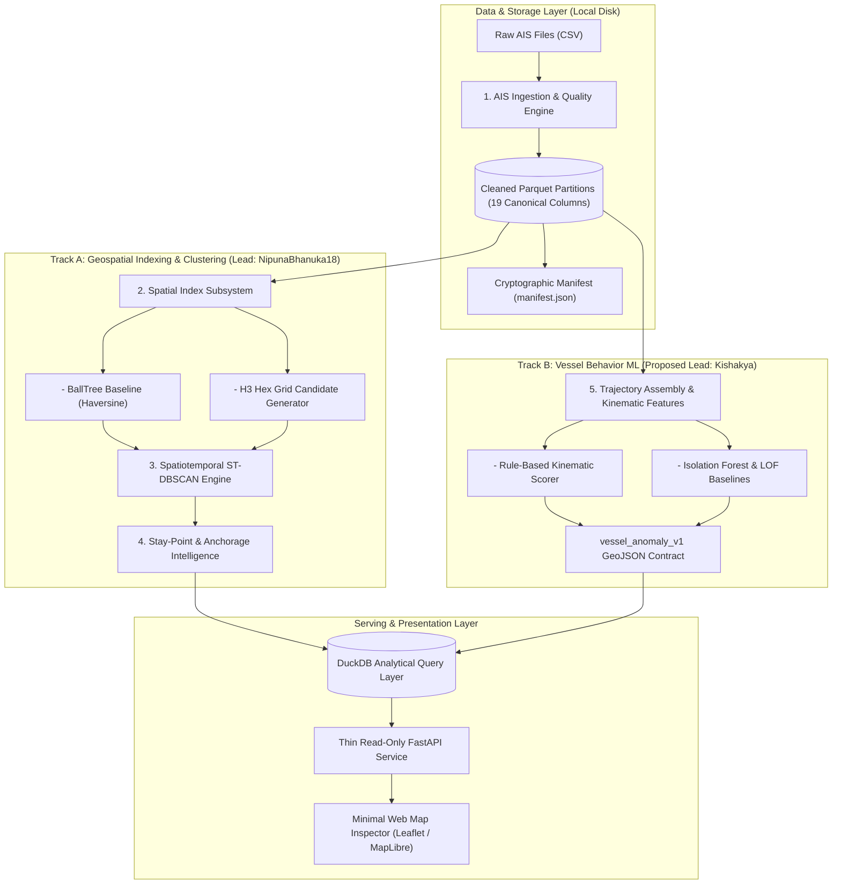

# System Architecture: AegisMar Modular Monolith

> **Project AegisMar: Explainable Maritime Traffic Intelligence & Vessel Behavior Anomaly Detection Platform**

**Document Version:** 2.2  
**Status:** Collaborative Architecture Baseline  
**Architectural Style:** Python-First Modular Monolith with Parallel Research Tracks  
**Research Tracks & Ownership:**  
- **Track A (Clustering & Platform Lead):** NipunaBhanuka18  
- **Track B (Vessel Behavior ML Track):** Kishakya *(proposed collaborator; participation pending review)*  
**Target Environment:** Localhost / Single-Node Analytical Workstation  

---

## 1. Architectural Principles

Project AegisMar is engineered as a **Python-first modular monolith**. The architecture supports collaborative research between two undergraduate AI researchers working on decoupled, complementary tracks:

1. **Track A (Clustering & Spatial Indexing Lead: NipunaBhanuka18)**: Owns the ingestion foundation, metric BallTree and discrete H3 spatial indexing, ST-DBSCAN clustering, stay-point/anchorage intelligence, shared DuckDB storage, and API serving.
2. **Track B (Vessel Behavior Anomaly Detection Lead: Kishakya, *proposed*)**: Owns vessel trajectory feature engineering, rule-based kinematic scoring, unsupervised anomaly modeling (Isolation Forest / LOF), and perturbation evaluation.

The system is governed by five non-negotiable architectural principles:
1. **Separation of Concerns via Clean Internal Boundaries**: Modules are organized by functional domain (`ingestion`, `spatial`, `clustering`, `staypoint`, `anomaly`, `storage`, `api`). Inter-module communication uses explicit Python interfaces and typed dataclasses.
2. **Data Immutability & Columnar Storage**: Raw AIS data files are read-only and preserved permanently. All cleaned records, spatial partitions, and analytical results are stored in Apache Parquet files, optimized for analytical querying via DuckDB.
3. **No Distributed Infrastructure**: The system eliminates external network servers, relational databases (PostgreSQL/PostGIS), message brokers (Kafka/RabbitMQ), and container orchestrators (Kubernetes).
4. **Precomputation Over Dynamic Computation**: Heavy spatiotemporal clustering and trajectory anomaly evaluations are executed offline in batch CLI pipelines, saving precomputed GeoJSON and Parquet artifacts that are served instantly by a thin read-only API.
5. **Contract-Based Subsystem Integration**: The ML anomaly track consumes the canonical PyArrow schema from `cleaned_ais.parquet` and exports results via the versioned `vessel_anomaly_v1` GeoJSON contract, ensuring complete modular decoupling.

---

## 2. High-Level Component Architecture

---

## 3. Subsystem Responsibilities

### 3.1 AIS Ingestion and Quality Validation (`aegismar.ingestion`)
- **Status:** Planned (Week 1, Milestone `W1-02`).
- **Responsibilities:**
  - Stream or chunk raw tabular AIS files (e.g., NOAA CSV/Parquet extracts).
  - Validate column types and enforce UTC ISO 8601 timestamp parsing.
  - Detect and mask ITU/NMEA sentinel values (`SOG == 102.3`, `Heading == 511`, `COG == 360.0`, `Status == 15`).
  - Quarantine invalid coordinates outside valid global bounds or dead-reckoning nulls $(0.0, 0.0)$.
  - Persist standardized, cleaned records into partitioned Apache Parquet files.

### 3.2 Trajectory Preparation (`aegismar.trajectory`)
- **Status:** Planned (Weeks 1–2).
- **Responsibilities:**
  - Partition cleaned AIS pings by distinct vessel identity (`MMSI`).
  - Sort pings chronologically with strict timestamp deduplication.
  - Compute inter-ping kinematic metrics: geodesic displacement $\Delta d$, elapsed time $\Delta t$, implied velocity $v_{\text{implied}}$, and angular course alterations.
  - Flag physical teleportation violations ($v_{\text{implied}} > 50\text{ kt}$).

### 3.3 Spatial Indexing: BallTree Baseline (`aegismar.spatial.balltree`)
- **Status:** Planned (Week 2).
- **Responsibilities:**
  - Project spherical coordinates (latitude, longitude) into radians.
  - Construct a `scikit-learn.neighbors.BallTree` configured with the haversine distance metric.
  - Execute spatial radius queries $\text{query\_radius}(p, r = \varepsilon / R_{\text{earth}})$.
  - Act as the primary spatial reference baseline for academic benchmarking.

### 3.4 Spatial Indexing: H3 Candidate Generator (`aegismar.spatial.h3_grid`)
- **Status:** Planned (Week 2).
- **Responsibilities:**
  - Map spatial pings to discrete hexagonal cell indices using Uber H3 (version 4.x API) at resolution $R$.
  - Generate candidate neighbor sets using $k$-ring cell expansion ($k \ge 1$) around target cells.
  - Guarantee that the cell radius at resolution $R$ and expansion order $k$ strictly envelopes the search radius $\varepsilon_{\text{spatial}}$ to prevent false negatives.
  - Perform exact geodesic haversine distance filtering on returned candidates.

### 3.5 Spatiotemporal ST-DBSCAN Clustering (`aegismar.clustering`)
- **Status:** Planned (Week 3).
- **Responsibilities:**
  - Combine spatial candidate generation (BallTree or H3) with temporal window constraints ($|t_p - t_q| \le \Delta T_{\text{temporal}}$).
  - Implement deterministic graph-traversal clustering logic.
  - Classify every point deterministically into: Core point, Border point, or Density Noise (`-1`).
  - Provide an interchangeable engine interface allowing identical clustering passes across both spatial indexes.

### 3.6 Anchorage Analytics & Stay-Point Extraction (`aegismar.staypoint`)
- **Status:** Planned (Week 4).
- **Responsibilities:**
  - Extract stay-points where vessel displacement remains below $\Delta D_{\text{max}}$ for duration $\ge \Delta T_{\text{min}}$.
  - Ingest GeoJSON berth and terminal polygons; perform spatial point-in-polygon tests.
  - Mark berthed vessels as `BERTHED` and isolate non-berth dwell points as true anchorage candidates.
  - Cluster non-berth stay-points to delineate geographic anchorage basins.
  - Calculate unique vessel dwell metrics ($\text{count}(\text{distinct } MMSI)$, median waiting hours) to avoid sampling-frequency skew.

### 3.7 Kinematic Trajectory Anomaly Analysis (`aegismar.anomaly`)
- **Status:** Proposed ML Track (Track Lead: Kishakya, *pending review*).
- **Responsibilities:**
  - Trajectory windowing and kinematic feature extraction (`aegismar.anomaly.features`):
    - Instantaneous acceleration and speed deltas ($\Delta \text{SOG} / \Delta t$).
    - Rate of turn ($\Delta \text{COG} / \Delta t$) and course-heading drift disparity ($|\text{COG} - \text{HDG}|$).
    - Transponder reporting intervals and coverage gap identification.
  - Transparent rule-based heuristic scoring engine (`aegismar.anomaly.rules`) outputting continuous score $\in [0.0, 1.0]$.
  - Unsupervised machine learning models (`aegismar.anomaly.models`): Isolation Forest and candidate alternative baselines (LOF / Mahalanobis).
  - Synthetic perturbation and leakage-free evaluation harness (`aegismar.anomaly.evaluation`).
  - Serialization of incident outputs conforming to the versioned `vessel_anomaly_v1` GeoJSON contract.
  - *Contract Note*: Raw Isolation Forest scores represent feature isolation depth and must never be represented as calibrated Bayesian probabilities of illicit intent.

### 3.8 Analytical Storage Layer (`aegismar.storage`)
- **Status:** Planned (Week 6).
- **Responsibilities:**
  - Store analytical tables in compressed Apache Parquet format.
  - Embed an in-process DuckDB query engine to execute instant analytical aggregations over Parquet without data copying.
  - Generate standards-compliant GeoJSON FeatureCollections for clusters, anchorages, and trajectory anomalies.

### 3.9 Orchestration & CLI Execution (`aegismar.cli`)
- **Status:** Planned (Weeks 2–7).
- **Responsibilities:**
  - Provide deterministic command-line entry points for batch operations:
    - `aegismar ingest <raw_path> <output_dir>`
    - `aegismar cluster --engine [balltree|h3] --eps-dist <meters> --eps-time <sec>`
    - `aegismar anchorages --berth-geojson <path>`
    - `aegismar anomalies --threshold <score>`
    - `aegismar serve --host 127.0.0.1 --port 8000`

### 3.10 Thin Read-Only API & Map Interface (`aegismar.api` & `aegismar.ui`)
- **Status:** Planned (Weeks 6–7).
- **Responsibilities:**
  - Serve precomputed GeoJSON files and DuckDB query results through a stateless, read-only FastAPI service running on `localhost:8000`.
  - Host a zero-build-step browser UI (vanilla HTML/JS + Leaflet or MapLibre) providing interactive layer toggles, trajectory inspection, and anomaly score detail modals.

---

## 4. Architectural Boundaries and Non-Violations

To preserve maintainability and stay strictly within the solo developer capacity:
- No module shall make direct network socket calls or require an external database server.
- The UI layer shall never perform dynamic clustering computations; all heavy scientific analytics remain precomputed.
- Test suites shall never depend on the availability of the web API or running services.

