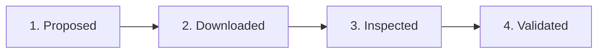

# Dataset Management & Quality Protocol

> **Project AegisMar: Explainable Maritime Traffic Intelligence & Vessel Behavior Anomaly Detection Platform**

**Document Version:** 2.1  
**Status:** Planning Baseline  
**Data Governance Policy:** Strictly Read-Only Raw Data; Never Commit Datasets  

---

## 1. Dataset Lifecycle Classification

To maintain scientific integrity and prevent unverified claims during early development, all datasets considered for Project AegisMar are tracked across four explicit lifecycle states:

1. **Proposed**: Dataset candidate identified, documented, and approved for acquisition. No data has been downloaded yet.
2. **Downloaded**: Raw files acquired and placed into `data/raw/` (gitignored). Raw files are marked read-only and preserved permanently.
3. **Inspected**: Data profiled for schema compatibility, column completeness, row counts, and date ranges.
4. **Validated**: Sentinel values masked, coordinate bounds checked, timestamps converted to UTC ISO 8601, and partitions successfully written to `data/processed/` Parquet files.

> [!IMPORTANT]
> **Current Repository State at W1-01:**  
> All candidate datasets are strictly in the **PROPOSED** state. No external datasets have been downloaded, inspected, or validated yet. Synthetic test fixtures in `data/samples/` or `tests/` are exclusively used for early unit testing.

---

## 2. Proposed Source: NOAA Marine Cadastre AIS

- **Source Organization**: U.S. National Oceanic and Atmospheric Administration (NOAA) / Bureau of Ocean Energy Management (BOEM).
- **Access URL**: [MarineCadastre.gov AIS Data](https://marinecadastre.gov/ais/)
- **License / Terms of Use**: Public Domain (U.S. Federal Government Work). No commercial or academic restrictions.
- **Data Format**: Tabular CSV and GeoParquet files, distributed in daily and monthly geographic partitions.
- **Expected Core Schema**:
  - `MMSI`: Maritime Mobile Service Identity (integer/string).
  - `BaseDateTime`: UTC timestamp (`YYYY-MM-DDTHH:MM:SS`).
  - `LAT` / `LON`: Geographic latitude and longitude in decimal degrees (WGS 84).
  - `SOG`: Speed Over Ground in knots (range: `0.0` to `102.2`; `102.3` = not available).
  - `COG`: Course Over Ground in degrees (range: `0.0` to `359.9`; `360.0` = not available).
  - `Heading`: True heading in degrees (range: `0` to `359`; `511` = not available).
  - `VesselName`, `IMO`, `CallSign`: Identification strings.
  - `VesselType`: Numeric ITU vessel classification code.
  - `Status`: Navigational status code (`0` to `15`).
  - `Length`, `Width`, `Draft`: Vessel physical dimensions in meters.

---

## 3. Candidate Coastal Study Regions & Selection Framework

For the 8-week MVP, research benchmarks will evaluate one primary coastal study region. At initialization, **no study region is selected**. Both candidate regions are evaluated against five objective selection criteria.

### 3.1 Candidate Study Regions

| Candidate Region | Geographic Bounding Box (WGS 84) | Maritime Characteristics | Current Status |
|---|---|---|---|
| **Los Angeles / Long Beach (US West Coast)** | Lat: `[33.5, 33.9]`, Lon: `[-118.4, -118.0]` | High-density container and tanker traffic, complex outer anchorage basins, well-defined breakwaters, prominent commercial dwell patterns. | **Candidate — Not Selected** |
| **Delaware Bay & Approach (US East Coast)** | Lat: `[38.5, 39.5]`, Lon: `[-75.6, -74.5]` | High tanker and bulk cargo volume, designated deep-water anchorage grounds (e.g., Big Stone Anchorage), distinct pilot boarding areas. | **Candidate — Not Selected** |

> [!NOTE]
> Neither region is declared selected at repository initialization. Formal selection will occur during Milestone W1-02 based on empirical data profiling. No external datasets have been downloaded.

### 3.2 Objective Region Selection Criteria

Selection between the candidate regions will be determined during W1-02 using the following five objective criteria:

1. **AIS Coverage & Message Quality**: Continuity of terrestrial/satellite receiver coverage, packet transmission density, and minimal reception shadows across the fairway and anchorage zones.
2. **Useful Anchorage Behavior**: Observable operational dwell patterns, diverse dwell durations (short wait vs. prolonged lay-up), and clear spatial separation between transit corridors, maneuvering basins, and stationary anchorages.
3. **Berth/Terminal Reference Data Availability**: Availability of authoritative, high-precision GeoJSON or shapefile polygons defining port berths, docks, and terminal piers required for spatial berth exclusion.
4. **Manageable Computational Size**: Filtered geographic bounding box yielding approximately 50,000 to 500,000 pings per 7-day observation window, ensuring compatibility with single-workstation memory bounds without out-of-core thrashing.
5. **Data Permissions & Licensing**: Verified open public-domain licensing (U.S. Federal Government / NOAA Marine Cadastre) with zero legal, academic, or export restrictions.

---

## 4. Dataset Acquisition & Validation Checklist

Before any raw dataset is promoted from **Proposed** to **Validated**, it must pass this verification checklist:

- [ ] **Permissions & Licensing**: Public domain or research-authorized license verified.
- [ ] **Storage Segregation**: Raw files stored strictly under `data/raw/` with read-only file permissions; verified excluded from Git tracking via `.gitignore`.
- [ ] **Cryptographic Integrity**: SHA-256 hash computed and recorded upon initial download.
- [ ] **Temporal Coverage**: Pings span at least 7 consecutive days to capture representative weekly port cycles.
- [ ] **Timestamp Continuity**: Timestamps verified monotonically increasing per `MMSI` without time reversals.
- [ ] **Field Availability**: All essential kinematic fields (`LAT`, `LON`, `BaseDateTime`, `SOG`, `COG`, `Heading`, `MMSI`) confirmed present.
- [ ] **Reporting Interval Consistency**: Reporting frequencies profiled across underway vs. stationary vessels.
- [ ] **Sentinel Quality Audit**: Percentage of records containing sentinels (`SOG==102.3`, `HDG==511`, `Status==15`) quantified and documented.
- [ ] **Implied Speed Sanity**: Teleportation pings ($v_{\text{implied}} > 50\text{ kt}$) flagged and separated.
- [ ] **Reference Data Availability**: Berth and terminal polygon GeoJSON obtained for the target port region to support berth exclusion.

