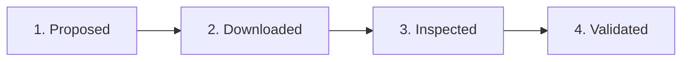
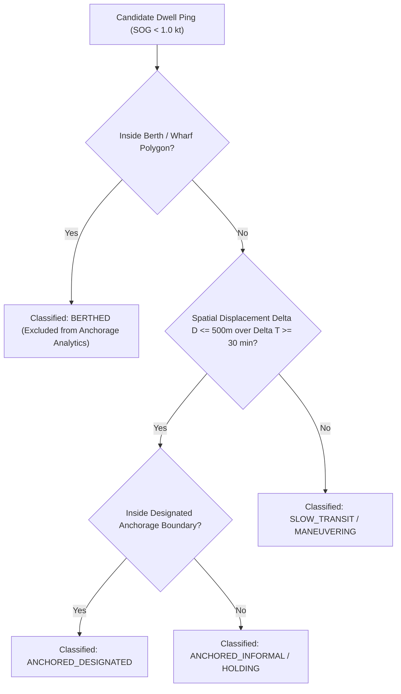

# Dataset Management & Quality Protocol

> **Project AegisMar: Explainable Maritime Traffic Intelligence & Vessel Behavior Anomaly Detection Platform**

**Document Version:** 2.1  
**Status:** Study Region Selected & Source Profiled (Milestone W1-02A)  
**Data Governance Policy:** Strictly Read-Only Raw Data; Never Commit AIS Datasets  

---

## 1. Dataset Lifecycle Classification

To maintain scientific integrity and prevent unverified claims, all datasets considered for Project AegisMar are tracked across four explicit lifecycle states:

1. **Proposed**: Dataset candidate identified, documented, and approved for acquisition. No data downloaded.
2. **Downloaded**: Raw bytes acquired and preserved in an ignored local directory (`data/raw/`). Raw source bytes are immutable.
3. **Inspected**: Data profiled for schema compatibility, column types, coordinate distributions, sentinel values, and temporal continuity.
4. **Validated**: Sentinel values masked, coordinate bounds validated, timestamps converted to UTC ISO 8601, and partitions successfully written to analytical Parquet files (`data/processed/`).

> [!IMPORTANT]
> **Dataset Status after Milestone W1-02A (2026-11-14):**  
> - **Nationwide 2025 Raw Daily Extract (`ais-2025-01-01.csv.zst`)**: **DOWNLOADED & INSPECTED** (Preserved in `data/raw/`, not yet Validated).  
> - **Primary Study Region (Los Angeles / Long Beach)**: **SELECTED & INSPECTED** (143,156 raw pings extracted and profiled; awaiting pipeline validation in W1-02B).  
> - **Secondary Candidate (Delaware Bay & Approach)**: **INSPECTED — NOT SELECTED FOR PRIMARY MVP** (42,838 raw pings profiled).  
> - **Validation Status**: Neither dataset is marked Validated until the production ingestion pipeline, sentinel coercion, and Parquet persistence are implemented and tested in W1-02B.

---

## 2. Authoritative Source: NOAA Marine Cadastre AIS

- **Originating Agency**: U.S. Coast Guard Navigation Center (NAIS collection) in partnership with the Bureau of Ocean Energy Management (BOEM) and NOAA Office for Coastal Management (OCM).
- **Metadata Record**: NOAA Fisheries InPort Item 77594 ([Nationwide AIS 2025](https://www.fisheries.noaa.gov/inport/item/77594)), published 2025-01-01.
- **Bulk Access URL**: `https://noaaocm.blob.core.windows.net/ais/csv2/csv2025/index.html` (Azure Blob Storage).
- **License / Terms of Use**: Public Domain (U.S. Government Work / CC0 equivalent). Unrestricted access and redistribution permitted with standard attribution.
- **Access & Acquisition Date**: 2026-11-14.
- **Acquired File Specification**:
  - Filename: `ais-2025-01-01.csv.zst`
  - Compressed File Size: 192.82 MB (202,190,247 bytes)
  - Compression Format: Zstandard (.zst)
  - Cryptographic Integrity: SHA-256 `36c07f4abad24f86fdd2ae8722b5a1d9422f3a223efc3482a568665275bdde53`
  - Total Nationwide Records: 7,337,208 broadcast observations across 24.0 UTC hours.

---

## 3. Real 2025 NOAA Schema vs. Legacy & Canonical Schema

Inspection of `ais-2025-01-01.csv.zst` and NOAA's official July 2026 Data Dictionary reveals that beginning in 2025, NOAA instituted significant updates to its AIS CSV products:

| Field Name (2025) | Legacy Name (2018–2024) | Source Type (2025) | Nullable? | AegisMar Canonical Mapping | Schema Evolution & Sentinel Handling Notes |
|---|---|---|---|---|---|
| `mmsi` | `MMSI` | `int32` | No | `mmsi: string` (9 chars) | Converted from Text(9) to int32 by NOAA. Ingestion validates integer format and zero-pads to a 9-character string to preserve leading zeroes (ADR-003). |
| `base_date_time` | `BaseDateTime` | `datetime64[ns]` | No | `timestamp_utc: timestamp[us, UTC]` | ISO 8601 UTC string (`YYYY-MM-DD HH:MM:SS`). Strictly monotonic per vessel in test sample. |
| `longitude` | `LON` | `double` (WGS 84) | No | `longitude: float64` | Reordered before latitude in 2025 format. Domain: `[-179.99999, 179.99999]`. |
| `latitude` | `LAT` | `double` (WGS 84) | No | `latitude: float64` | Reordered after longitude. Domain: `[-89.99999, 89.99999]`. |
| `sog` | `SOG` | `float` (knots) | Yes | `sog: float32` | Domain: `[0.0, 99.9]`. Legacy sentinels (`102.3`) are now emitted as null values by NOAA. |
| `cog` | `COG` | `float` (degrees) | Yes | `cog: float32` | Domain: `[0.0, 359.9]`. Legacy sentinels (`360.0`) are emitted as null values. |
| `heading` | `Heading` | `int32` (degrees) | Yes | `heading: float32` | Scaled to whole numbers in 2025. Legacy sentinels (`511`) are emitted as null values. |
| `vessel_name` | `VesselName` | `string` (UTF-8) | Yes | `vessel_name: string` | Station radio license name (up to 24 chars). |
| `imo` | `IMO` | `string` | Yes | `imo: string` | International Maritime Organization number (e.g. `IMO9212424`). Empty for small craft. |
| `call_sign` | `CallSign` | `string` | Yes | `call_sign: string` | Radio call sign assigned by FCC or flag state. |
| `vessel_type` | `VesselType` | `int32` | Yes | `vessel_type: int16` | ITU numeric classification (e.g., 70=Cargo, 52=Tug, 37=Pleasure, 30=Fishing). |
| `status` | `Status` | `int32` | Yes | `nav_status: int8` | Domain `[0, 14]`. Status 15 (undefined/default) is emitted as null by NOAA in 2025. |
| `transceiver` | `TransceiverClass` | `string` (`A`\|`B`) | Yes | `transceiver_class: string` | Shortened field name. Class A (commercial SOLAS) vs Class B (small craft). |

**Canonical schema scope (aligned with [ADR-003](../02-architecture/decisions/ADR-003-canonical-schema-and-quality-flags.md) and [`src/aegismar/ingestion/schema.py`](../../src/aegismar/ingestion/schema.py)).**
- **Mapped fields:** the 13 rows above are the source fields mapped by `NOAA_2025_MAPPINGS` / `NOAA_LEGACY_MAPPINGS`.
- **Source fields not ingested:** the NOAA source also carries `length`, `width`, `draft` and `cargo`. These are not mapped and do not appear in the cleaned Parquet.
- **The 19 canonical columns** are:
  - `source_row`
  - the 13 mapped fields
  - the derived movement columns `prev_source_row`, `elapsed_seconds`, `distance_nm` and `implied_speed_knots`
  - `quality_flags`
- **Row order:** rows are sorted by `(mmsi, timestamp_utc, source_row)` (`CANONICAL_ROW_ORDER`, ADR-011).

---

## 4. Empirical Study Region Comparison

Both candidate study regions were extracted and profiled from the complete 24-hour nationwide sample (`2025-01-01`):

| Evaluation Criterion | Candidate A: Los Angeles / Long Beach, CA | Candidate B: Delaware Bay & River Approach, DE/NJ/PA | Comparative Assessment |
|---|---|---|---|
| **Geographic Bounds (WGS 84)** | Lat: `[33.5, 33.9]`, Lon: `[-118.4, -118.0]` | Lat: `[38.5, 39.5]`, Lon: `[-75.6, -74.5]` | LA/LB encompasses San Pedro Bay; Delaware covers mouth through lower river. |
| **Observation Count (1 Day)** | **143,156 observations** | **42,838 observations** | LA/LB provides 3.3× data density, directly fulfilling the 10k, 50k, 100k benchmark tiers. |
| **Unique Vessels (MMSI)** | **362 vessels** | **95 vessels** | LA/LB exhibits substantially higher unique-vessel diversity and traffic volume. |
| **Anchorage Activity** | **8,569 at-anchor pings (6.0%)** | **3,175 at-anchor pings (7.4%)** | LA/LB features designated outer deep-water anchorages (Anchorages F & G) outside the breakwater. |
| **Moored / Berth Activity** | **19,716 moored pings (13.8%)** | **4,284 moored pings (10.0%)** | LA/LB contains vast inner terminal docks clearly separated by the breakwater. |
| **Underway Activity** | **36,618 underway pings (25.6%)** | **13,471 underway pings (31.5%)** | Active transit corridors in both ports. |
| **Null Navigational Status** | 74,924 (52.3%) | 17,494 (40.8%) | Preprocessed ITU sentinel status 15; highlights need for stay-point extraction. |
| **Missing SOG / COG** | SOG: 13 (0.01%), COG: 29,102 (20.3%) | SOG: 1 (0.00%), COG: 4,371 (10.2%) | SOG is 99.99% complete; COG nulls correspond with stationary/moored vessels. |
| **Median Reporting Interval** | **179.0 s** (~3 minutes) | **101.0 s** (~1.7 minutes) | Reflects standard 3-minute stationary broadcast intervals for anchored/moored vessels. |
| **Implied Speed Violations (>50 kt)**| **18 instances** | **0 instances** | LA/LB contains authentic kinematic anomalies providing ground truth for anomaly testing. |
| **Identical Duplicate Coordinates** | 32 duplicate pings | 3 duplicate pings | Minor sensor artifact cleanly handled by temporal deduplication. |
| **Berth Reference Data Feasibility** | **High** (GeoPOLA / Port of Long Beach open GIS) | **Moderate** (Scattered along 100-mile river corridor to Philadelphia) | Compact, well-defined harbor geometry favors LA/LB for berth exclusion. |
| **Project Fit (8-Week Solo Scope)** | **Ideal**: Self-contained coastal sector with clear water-to-land boundary. | **Challenging**: Linear river estuary requiring large bounding box to capture berths. | LA/LB minimizes spatial indexing border distortion. |

---

## 5. Study Region Selection Decision

**Selected Study Region:** **Los Angeles / Long Beach (San Pedro Bay), California**  
**Lifecycle Status:** **Selected, Inspected & Validated** (Extract preserved in `data/raw/sample_lalb_20250101.csv`, 143,156 records; ingested and validated into `data/processed/lalb_20250101/cleaned_ais.parquet`, 143,124 canonical rows). **Versions:** that folder holds the historical v1.0 file; the canonical cleaned dataset since 2026-11-25 is v1.1 in `data/processed/lalb_20250101_v1_1/` (file SHA-256 `bdde2581...`, fingerprint `d8a619f7...`). See [evidence-register.md §2.1](evidence-register.md).

| Version | Status | Path | File SHA-256 | Logical fingerprint (`aegismar-logical-v1`) |
|---|---|---|---|---|
| **v1.1** | **Canonical** (Track A from W3-02; Track B) — immutable | `data/processed/lalb_20250101_v1_1/cleaned_ais.parquet` | `bdde2581302270a9e2c99a1a7aa1819a0bd1a24fbf6384458cfd8a81229eaf48` | `d8a619f7d27314ae8418eff5da8e1c5c96004d038c2fce8f5ee868ed90fec2cf` |
| **v1.0** | Archived historical baseline (W2-01, W3-01/W3-01B) — immutable | `data/processed/lalb_20250101/cleaned_ais.parquet` | `4a7ca719dc2a3d9959cc4166edff773ca09156d8d914e54d0ab5f851ece5e88b` | `570b0fb09182720fc476b4b712c0d599bed3ed34491aad4946719fab965a1473` |

- Both versions have 143,124 rows. They differ only in 12 rows of the derived movement columns.
- After the default quality filter, both give the same 143,116-row clustering input.
- Never regenerate either version with `--overwrite`. Confirm a local copy with `aegismar fingerprint`.

### Selection Justification
1. **Direct Alignment with Benchmark Scales**: A single 24-hour slice yields 143,156 valid pings across 362 unique vessels, enabling immediate sampling at the 10,000, 50,000, and 100,000 benchmark scales without multi-day concatenation.
2. **Distinct Anchorage Geometry**: San Pedro Bay possesses famous designated commercial anchorages (commercial anchorages outside the San Pedro and Long Beach breakwaters) that are physically separated from inner container terminals.
3. **Availability of Official Berth Reference Polygons**: Both the Port of Los Angeles (GeoPOLA) and the Port of Long Beach (MapsLB) publish precise open GIS vector boundaries for berth lines and terminal wharves.
4. **Authentic Kinematic Deviations**: The presence of 18 genuine implied-speed anomalies ($v_{\text{implied}} > 50\text{ kt}$) and high stationary dwell periods provides concrete test cases for the anomaly and stay-point engines.

---

## 6. Anchorage & Berth Feasibility Framework

To prevent confusion between anchored vessels, docked vessels, slow-moving vessels, and sensor dwell artifacts, AegisMar establishes a four-way spatial and kinematic disambiguation framework:

### Operational Definitions
1. **Vessel Waiting Offshore**: Located outside the breakwater/terminal polygons in water depths $> 10\text{ m}$; speed $< 1.0\text{ kt}$; contiguous dwell duration $\ge 30\text{ minutes}$; grouped into an anchorage cluster aggregated by unique `MMSI`.
2. **Vessel Alongside Berth**: Spatial coordinates fall inside port terminal polygons or within $\le 50\text{ m}$ of a wharf face; speed $\le 0.2\text{ kt}$; status usually `5` (moored). Strictly excluded from anchorage dwell metrics.
3. **Vessel Moving Slowly in Channel**: Located inside the main entrance channel; speed $1.0\text{ to } 6.0\text{ kt}$; cumulative displacement between window endpoints $> \Delta D_{\text{max}}$.
4. **Sensor Dwell Artifact**: Repeated pings from an identical location ($\Delta d < 1\text{ m}$) due to base station echo; deduplicated by `(MMSI, BaseDateTime)`.

---

## 7. Dataset Acquisition & Validation Checklist

- [x] **Permissions & Licensing**: Public domain NOAA Marine Cadastre data verified; unrestricted academic and commercial use with attribution.
- [x] **Storage Segregation**: Raw files stored in `data/raw/` (`ais-2025-01-01.csv.zst`, `sample_lalb_20250101.csv`); confirmed 100% excluded from Git tracking via `.gitignore`.
- [x] **Cryptographic Integrity**: SHA-256 computed: `36c07f4abad24f86fdd2ae8722b5a1d9422f3a223efc3482a568665275bdde53`.
- [x] **Field Availability**: All 17 standardized 2025 NOAA fields verified present via direct decompression.
- [x] **Reporting Interval Distribution**: Profiled: median 179.0 s, 90th percentile 201.0 s, 99th percentile 719.0 s.
- [x] **Sentinel Audit**: Verified that 2025 NOAA data replaces sentinels (`102.3`, `511`, `15`) with null values.
- [x] **Implied Speed Sanity**: Profiled: 18 speed violations ($>50\text{ kt}$) cataloged in LA/LB sample.
- [x] **Berth Reference Geometry Identified**: Port of Los Angeles GeoPOLA and Port of Long Beach open GIS feature services verified.
- [x] **Production Ingestion & Parquet Storage**: Completed in Milestone W1-02B (`cleaned_ais.parquet`, 4.15 MB, zstd compression; in-memory batch ingestion; quality and schema rules hardened in W2-01).
- [x] **Final Pipeline Validation**: Completed in Milestone W1-02B (`manifest.json` cryptographic traceability with SHA-256 and schema metadata).
