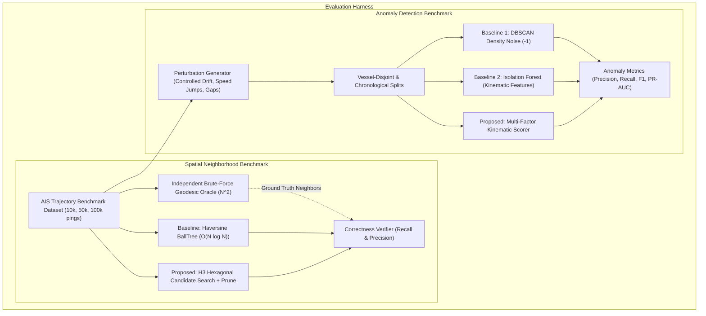

# Scientific Research Plan

> **Project AegisMar: Explainable Maritime Traffic Intelligence & Vessel Behavior Anomaly Detection Platform**

**Document Version:** 2.2  
**Status:** Approved Research Plan (Collaborative Dual-Track Model)  
**Research Tracks & Leadership:**  
- **Track A (Geospatial Clustering Lead & Platform Architect):** NipunaBhanuka18  
- **Track B (Vessel Behavior ML Track):** Kishakya *(Track Lead)*  
**Academic Focus:** Geospatial Machine Learning, Spatial Indexing & Maritime Domain Awareness  

---

## 1. Research Motivation & Problem Definition

Vessel traffic monitoring in busy coastal choke points, port approaches, and anchorages requires clustering high-density AIS telemetry to uncover navigational patterns and identifying anomalous movements that threaten navigational safety or port efficiency.

However, standard spatial clustering algorithms such as DBSCAN and its temporal extension, ST-DBSCAN, exhibit $O(N^2)$ worst-case time complexity. While metric tree structures such as `BallTree` (configured with geodesic/haversine distance) reduce average query complexity to $O(N \log N)$, building and querying trees over millions of high-dimensional spatiotemporal records remains computationally prohibitive on standard analyst workstations.

Discrete Global Grid Systems (DGGS), specifically Uber's hierarchical hexagonal H3 grid, provide a discrete spatial partitioning of the Earth's surface into regular hexagonal cells. While H3 has been used for spatial aggregation, its formal application as an exact, correctness-preserving candidate generator for spatiotemporal density-based clustering (ST-DBSCAN) has not been rigorously benchmarked against geodesic BallTree baselines with formal completeness guarantees.

Furthermore, existing maritime anomaly detection literature frequently suffers from two deficiencies:
1. Conflating spatial density outliers (e.g., vessels drifting in remote waters or waiting in anchorages) with genuine behavioral anomalies.
2. Relying on opaque "black box" deep learning models that fail to explain the physical maritime factors triggering an alert.

---

## 2. Research Questions (RQ)

- **Primary Research Question (RQ1 — Track A Lead: NipunaBhanuka18)**: Can an H3-accelerated candidate neighbor generation mechanism for ST-DBSCAN achieve a statistically significant reduction in total execution time compared to a Haversine BallTree baseline while strictly preserving spatial neighborhood recall ($\ge 99.9\%$) across varying AIS density distributions?
- **Secondary Research Question (RQ2 — Track B Lead: Kishakya)**: Does a trajectory-aware, explainable rule-based kinematic scoring engine achieve superior precision and reduced false alarm rates in identifying behavioral vessel anomalies compared to spatial point-density outlier baselines and unsupervised Isolation Forests? *(See detailed proposal in [vessel-behavior-ml.md](vessel-behavior-ml.md)).*

---

## 3. Formal Scientific Hypotheses

### Hypothesis 1 (H1: Algorithmic Acceleration & Correctness — Track A)
- **Null Hypothesis ($H_{1,0}$)**: At equal spatial search radius $\varepsilon_{\text{spatial}}$ and temporal threshold $\Delta T_{\text{temporal}}$, the H3-accelerated ST-DBSCAN candidate search yields no reduction in execution latency compared to the Haversine BallTree baseline, or results in a loss of neighborhood recall exceeding $0.1\%$ ($< 99.9\%$).
- **Alternative Hypothesis ($H_{1,A}$)**: An appropriately parameterized H3 candidate expansion ($k$-ring at resolution $R$) combined with geodesic haversine pruning achieves a statistically significant runtime reduction ($p < 0.05$ across 10 repeated benchmark trials) over the BallTree baseline on AIS datasets $\ge 50,000$ points while guaranteeing $\ge 99.9\%$ spatial neighbor recall against an independent brute-force oracle.

### Hypothesis 2 (H2: Trajectory Kinematic Explainability — Track B)
- **Null Hypothesis ($H_{2,0}$)**: A multi-factor kinematic trajectory scoring model yields an $F_1$ score less than or equal to an unsupervised spatial density outlier baseline when evaluated against ground-truth and physically perturbed anomalous maritime trajectories.
- **Alternative Hypothesis ($H_{2,A}$)**: A multi-factor kinematic trajectory scoring model (evaluating velocity jumps, abnormal drift angles, and transponder coverage gaps) achieves an $F_1$ score at least 15 percentage points higher than density-based outlier detection, while providing an exact physical breakdown for 100% of detected alerts.

---

## 4. Experimental Methodology & Baselines

### 4.1 Methodological Foundations & Research Correctness

To ensure rigorous and unassailable scientific evaluation, the experimental pipeline enforces ten non-negotiable principles:

1. **Exact Spatial and Temporal Filtering**: H3 grid candidate expansion and BallTree queries serve strictly as candidate filtering mechanisms; candidate pairs must satisfy both exact geodesic distance ($d_{\text{haversine}}(p, q) \le \varepsilon_{\text{spatial}}$) and exact temporal window ($|t_p - t_q| \le \Delta T_{\text{temporal}}$) before neighborhood admission.
2. **Deterministic Clustering Semantics**: ST-DBSCAN implementations use a shared, provider-agnostic **core-first deterministic labeling policy (`stdbscan-core-first-v1.0`)** (implemented in W2-01): inputs are sorted by canonical total order `(timestamp_us, mmsi, latitude_deg, longitude_deg, source_row)`; core status is computed from the full eligible neighborhood; core connected components are numbered by minimum canonical core index; and border points attach to the eligible core neighbor minimizing `(haversine_distance_m, |dt_us|, cluster_id, core_index)`. This eliminates sequential queue-order dependence and ensures exact comparability between BallTree (implemented in W2-01) and H3 (implemented in W3-01; verified with 100% exact role and label parity on synthetic and real datasets).
3. **H3 Candidate Completeness Across Boundaries & Pentagons**: H3 candidate search radius ($k$-ring at resolution $R$) must strictly circumscribe $\varepsilon_{\text{spatial}}$, explicitly evaluating points near hexagonal cell boundaries ($\delta \le 10\text{ m}$) and across the 12 icosahedral pentagonal distortion zones to guarantee zero dropped candidates.
4. **Equivalent Clustering Semantics in Benchmarks**: The BallTree baseline and the H3-accelerated engine must execute with identical parameters ($\varepsilon_{\text{spatial}}$, $\Delta T_{\text{temporal}}$, $\text{min\_samples}$), isolating spatial index traversal performance from algorithmic divergence.
5. **Inclusion of Indexing Overhead**: Total benchmark wall-clock comparisons must record index construction latency ($T_{\text{build}}$) in addition to candidate query ($T_{\text{query}}$) and geodesic pruning ($T_{\text{prune}}$), evaluating net end-to-end efficiency.
6. **Real Dataset Profiling Prior to Sample Selection**: Before finalizing benchmark slices, candidate historical AIS extracts must be empirically profiled for packet rates, sentinel frequency, and spatial coverage to ensure benchmark samples represent genuine maritime operating conditions.
7. **Vessel-Disjoint & Chronological Holdouts**: Evaluation partitions must enforce chronological holdouts for time-series forecasting and vessel-disjoint splits (`MMSI` partitioning) for machine learning models to prevent cross-trajectory contamination.
8. **Physically Plausible Anomaly Perturbations**: Anomaly evaluation leverages documented, kinematic perturbations (speed discontinuities, drifting, coverage dropouts) parameterized according to commercial merchant vessel operational limits.
9. **Strict Data-Leakage Prevention**: Feature scaling, trajectory transformations, and outlier thresholds must be fitted exclusively on training sets before application to held-out evaluation partitions.
10. **Absolute Truth in Benchmarking**: Zero performance numbers, runtimes, recall figures, or research outcomes shall be simulated or fabricated. All reported figures must derive from automated benchmark logs.

### 4.2 Baselines for Comparison
1. **Spatial Indexing & Clustering Baselines**:
   - *Reference Oracle*: Brute-force pairwise Haversine distance matrix computation ($O(N^2)$).
   - *Metric Tree Baseline*: `scikit-learn.neighbors.BallTree` configured with `metric='haversine'`.
2. **Anomaly Detection Baselines**:
   - *Density Outlier Baseline*: Points classified as noise (`-1`) by ST-DBSCAN.
   - *Unsupervised Learning Baseline*: Scikit-learn `IsolationForest` fitted on normalized kinematic vectors $(\Delta v, \text{ROT}, |\text{COG} - \text{HDG}|, \Delta t_{\text{gap}})$.

---

## 5. Evaluation Metrics

### 5.1 Clustering & Indexing Metrics
- **Neighbor Recall ($R_{\text{neighbor}}$)**: $\frac{|N_{\text{H3}}(p) \cap N_{\text{oracle}}(p)|}{|N_{\text{oracle}}(p)|}$.
- **Neighbor Precision ($P_{\text{neighbor}}$)**: $\frac{|N_{\text{H3}}(p) \cap N_{\text{oracle}}(p)|}{|N_{\text{H3}}(p)|}$.
- **Adjusted Rand Index (ARI)**: Concordance between cluster labels generated by BallTree ST-DBSCAN vs. H3 ST-DBSCAN.
- **Wall-Clock Query Runtime ($t_{\text{query}}$)**: Mean execution time across 10 deterministic runs.
- **Index Build Time ($t_{\text{build}}$)**: Time required to index the dataset into BallTree vs H3 cell hashes.
- **Peak Memory Footprint ($\text{RAM}_{\text{peak}}$)**: Maximum resident memory measured via process instrumentation.

### 5.2 Anomaly Detection Metrics
- **Precision, Recall, and $F_1$ Score**: Evaluated against documented, physically plausible synthetic perturbations on clean trajectories.
- **Precision-Recall AUC (PR-AUC)**: Evaluates ranking quality across continuous anomaly score thresholds.
- **Explainability Coverage**: Percentage of detected anomalous incidents that produce a deterministic, verifiable physical factor breakdown.

---

## 6. Reproducibility Requirements

1. **Deterministic Seeds**: All random number generators (e.g., test perturbations, train/test partition splits, Isolation Forest estimators) must take explicit, fixed integer seeds recorded in experiment configurations.
2. **Hardware Environment Logging**: Every benchmark output JSON must capture CPU model, core count, available memory, OS version, and exact package versions (`uv.lock`).
3. **Immutability of Evaluation Data**: Input data partitions must remain strictly read-only and referenced by cryptographic hash (SHA-256).

---

## 7. Research Limitations

- **Geographic Boundary**: Empirical validation is constrained to candidate coastal sectors with heavy traffic (e.g., Los Angeles / Long Beach or Delaware Bay) and does not cover open-ocean polar routes.
- **Single-Node Execution**: Benchmarks are evaluated on a single standard workstation, testing algorithmic efficiency rather than distributed cluster scaling.
- **Absence of Classified Ground Truth**: Public AIS data lacks official coast guard enforcement records; ground truth for anomalies is established through physical law verification and documented synthetic perturbation injection.

