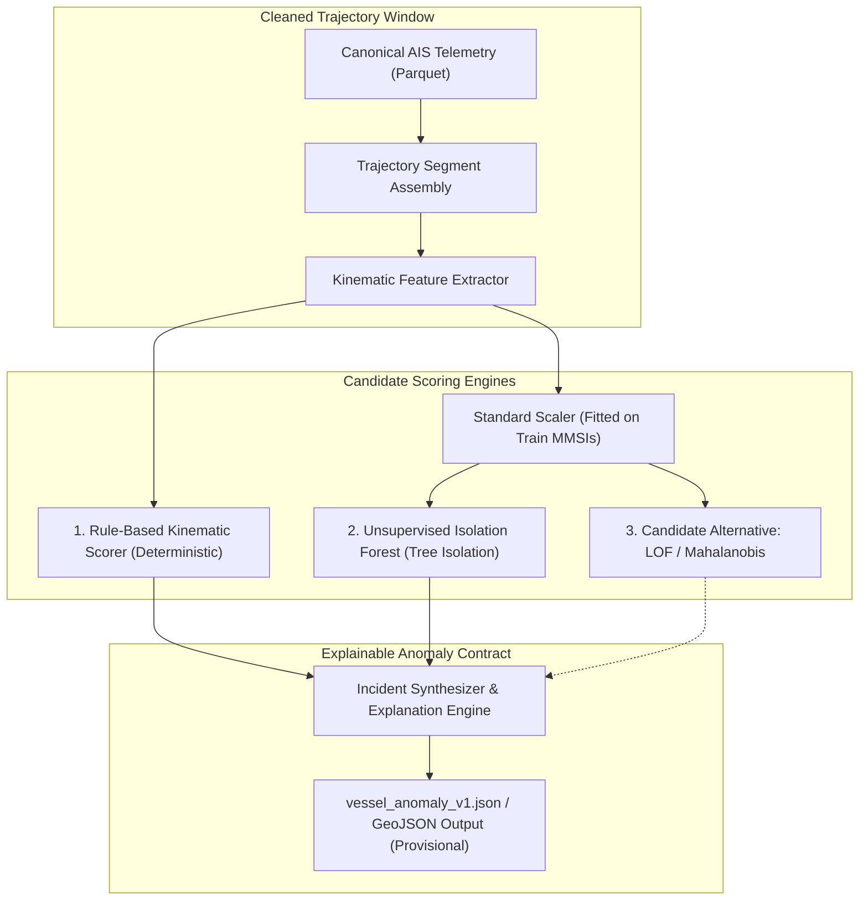

# Machine Learning Vessel Behavior Anomaly Detection Research Proposal

> **Project AegisMar: Explainable Maritime Traffic Intelligence & Vessel Behavior Anomaly Detection Platform**  
> **Document Version:** 1.1 (PROPOSAL — NOT FINALIZED)  
> **Lifecycle Status:** Candidate Research Proposal (Subject to Collaborator Review & Revision)  
> **Proposed Research Contributor:** Kishakya *(participation, scope, and attribution pending review)*  
> **Project Lead & Platform Architecture:** NipunaBhanuka18  
> **Date:** 2026-11-22  

---

> [!IMPORTANT]
> **PROPOSAL — NOT FINALIZED**  
> This document constitutes a proposed research and experimentation roadmap for the Machine Learning (ML) Vessel Behavior Anomaly Detection track of Project AegisMar. Kishakya is entirely free to evaluate, refine, amend, or restructure the problem statement, feature engineering definitions, model selection, baseline architectures, and evaluation methodology defined herein.
> 
> **Scientific Integrity Notice**:
> - No machine learning models have yet been implemented or trained in the codebase.
> - All hypotheses ($H_{\text{ML1}}, H_{\text{ML2}}$) represent untested propositions awaiting empirical evaluation.
> - Any example incident identifiers, vessel names, coordinates, and anomaly scores appearing in this document are **purely synthetic documentation examples** and do not represent authentic maritime incidents.

---

## 1. Research Motivation

Maritime Domain Awareness (MDA) requires coastal monitoring authorities, port operators, and security agencies to continuously survey vessel traffic patterns across congested waterways, approaches, and anchorages. The Automatic Identification System (AIS) serves as the primary open telemetry broadcast system mandated by the International Maritime Organization (IMO) for commercial vessels.

However, operational anomaly detection on raw AIS feeds presents severe analytical challenges:
1. **Conflation of Density Noise and Kinematic Anomalies**: Conventional spatial density algorithms (such as DBSCAN or ST-DBSCAN) identify unclustered points as spatial noise. In maritime operations, an isolated vessel transiting a low-density open lane is not necessarily anomalous, whereas a vessel executing erratic turns or unannounced speed drops inside a dense shipping fairway is highly anomalous. Spatial outlier status does not equal behavioral risk.
2. **Alert Fatigue from Sensor Artifacts**: Marine GPS telemetry frequently suffers from multi-path reflections, receiver antenna shielding, dead-reckoning dropouts, and sentinel broadcast values (e.g., SOG 102.3 kt, Heading 511°). Naive anomaly detectors trigger high volumes of false alerts on benign sensor glitches.
3. **Black-Box Opacity**: Many contemporary machine learning anomaly detection papers propose high-dimensional recurrent or deep architectures that emit uncalibrated scalar risk scores without physical justification. Maritime operational literature emphasizes that operators cannot act effectively on uninterpretable scores when deploying inspection resources or safety interventions.

This research track addresses the need for **physically interpretable, trajectory-aware vessel behavior anomaly detection** that reliably distinguishes benign sensor artifacts and operational dwelling from genuine kinematic abnormalities.

---

## 2. Proposed Problem Statement

Given a set of historical, quality-validated AIS observation pings partitioned by unique vessel identity $\text{MMSI}_v$ and ordered chronologically:

$$T_v = \langle p_1, p_2, \dots, p_N \rangle, \quad p_i = (\text{timestamp}_i, \text{lat}_i, \text{lon}_i, \text{sog}_i, \text{cog}_i, \text{heading}_i, \dots)$$

The objective is to formulate an anomaly detection subsystem that:
1. Reconstructs coherent, continuous trajectory segments or sliding analytical windows $W \subseteq T_v$.
2. Extracts domain-specific kinematic, geometric, and temporal reporting features from $W$.
3. Evaluates $W$ against an explainable scoring baseline and an unsupervised machine learning model to assign an anomaly score $S(W) \in [0.0, 1.0]$.
4. Decomposes $S(W)$ into an interpretable vector of contributing physical factors (e.g., abrupt velocity change, heading-drift disparity, abnormal loitering outside designated zones, or coverage gaps).

---

## 3. Candidate Research Questions and Hypotheses

### Primary ML Research Question (RQ-ML1)
*Can a trajectory-aware kinematic feature representation (incorporating velocity differentials, angular course acceleration, heading-course disparity, and transponder reporting intervals) distinguish abnormal vessel maneuvers from normal navigation with statistically lower false-positive rates than spatial point-density outlier baselines?*

### Secondary ML Research Question (RQ-ML2)
*Does an unsupervised machine learning model (such as Isolation Forest or LOF) trained on vessel-disjoint kinematic feature vectors achieve superior anomaly ranking performance (measured via Precision-Recall AUC) compared to hard-threshold rule-based scoring, while maintaining transparent physical factor attribution?*

### Candidate Formal Hypotheses

#### Hypothesis ML-1 (Kinematic Features vs. Spatial Density Outliers)
- **Null Hypothesis ($H_{\text{ML1}, 0}$)**: Trajectory anomaly scoring using kinematic feature representations yields an $F_1$ score less than or equal to an ST-DBSCAN spatial density noise baseline ($S_{\text{noise}} = -1$) when evaluated on physically perturbed maritime trajectories.
- **Alternative Hypothesis ($H_{\text{ML1}, A}$)**: Trajectory anomaly scoring using kinematic features achieves an $F_1$ score at least 15 percentage points higher than the spatial density noise baseline across held-out vessel evaluation partitions.

#### Hypothesis ML-2 (Model Ranking & Explainability)
- **Null Hypothesis ($H_{\text{ML2}, 0}$)**: An unsupervised Isolation Forest model trained on normalized trajectory kinematic features yields no statistically significant improvement in Precision-Recall AUC ($p \ge 0.05$) over a heuristic rule-based scorer, or fails to explain at least 90% of true positive alerts with the correct injected perturbation factor.
- **Alternative Hypothesis ($H_{\text{ML2}, A}$)**: An unsupervised Isolation Forest model yields a statistically significant improvement in PR-AUC ($p < 0.05$) over rule-based scoring on test splits, while preserving $\ge 90\%$ attribution accuracy for the primary physical perturbation factor.

*(Note: These hypotheses are currently unverified. The ML track has not yet evaluated any model against the rule-based baseline.)*

---

## 4. Available AIS Fields and Operational Limitations

The canonical cleaned Parquet dataset generated by the AegisMar ingestion engine (`data/processed/lalb_20250101/cleaned_ais.parquet`) provides 19 standardized columns. The ML track must account for the specific domain semantics and physical limitations of each field:

| Field Name | Canonical Type | Physical Semantic | Known Operational Limitations for ML |
|---|---|---|---|
| `source_row` | `int64` | 1-based CSV line number | Audit reference only; do not use as an ML feature. |
| `mmsi` | `string` (9-char) | Maritime Mobile Service Identity | Categorical entity key. Used for vessel partitioning; never use as a numeric feature. |
| `timestamp_utc` | `timestamp[us, UTC]` | Observation broadcast time | Microsecond resolution; broadcast intervals vary from 2 s (fast transit) to 3+ min (stationary). |
| `latitude` | `float64` | WGS 84 latitude degrees | Subject to GPS multipath near port structures; bounded to $[-90.0, 90.0]$. |
| `longitude` | `float64` | WGS 84 longitude degrees | Subject to GPS multipath; bounded to $[-180.0, 180.0]$. |
| `sog` | `float32` (nullable) | Speed Over Ground (knots) | Nullable. Legacy sentinel `102.3` nullified. GPS Doppler speeds can exhibit jitter at near-zero speeds. |
| `cog` | `float32` (nullable) | Course Over Ground (degrees) | Nullable. Legacy sentinel `360.0` nullified. At $\text{SOG} < 0.5\text{ kt}$, COG fluctuates erratically due to sensor noise. |
| `heading` | `float32` (nullable) | True Heading (degrees) | Nullable. Legacy sentinel `511` nullified. Frequently missing on small craft, tugs, or pleasure craft without gyrocompasses. |
| `nav_status` | `int8` (nullable) | Navigational status (0–14) | Frequently misconfigured manually by crew (e.g., status `0` "underway" while moored at berth). Status `15` nullified. |
| `vessel_type` | `int16` (nullable) | ITU ship type code | Coarse category (e.g., 70=Cargo, 80=Tanker, 52=Tug, 30=Fishing). Useful for stratified kinematic thresholds. |
| `vessel_name` | `string` (nullable) | Station radio license name | Metadata string for analyst display; not a feature. |
| `imo` | `string` (nullable) | IMO registration number | Missing on non-SOLAS vessels, barges, and small craft. |
| `call_sign` | `string` (nullable) | Radio call sign | Metadata string; not a feature. |
| `transceiver_class`| `string` (nullable) | Class `A` (SOLAS) vs `B` | Class B transmits at lower power and lower frequency; reporting intervals differ significantly. |
| `prev_source_row` | `int64` (nullable) | Preceding valid ping row | Traceability pointer in cleaned dataset. |
| `elapsed_seconds` | `float64` (nullable) | Time delta from previous ping | Essential for computing rate-of-change; can be large across coverage dropouts. |
| `distance_nm` | `float64` (nullable) | Geodesic displacement (NM) | Calculated via Haversine metric. Null on first vessel observation or after timestamp conflict. |
| `implied_speed_knots` | `float64` (nullable) | $\Delta d / \Delta t$ in knots | Ground-truth physical speed check. Teleportation ($>50\text{ kt}$) flagged in quality flags. |
| `quality_flags` | `list[string]` | Analytical quality warnings | Contains flags: `TIMESTAMP_POSITION_CONFLICT`, `IMPLIED_SPEED_VIOLATION`, `MISSING_SOG`, etc. |

---

## 5. Vessel Trajectory Reconstruction Assumptions

Before feature extraction, raw pings must be assembled into valid trajectory windows:
1. **Partitioning**: Telemetry must be strictly partitioned by `mmsi`. No cross-vessel feature computation is permitted.
2. **Chronological Sorting**: Within each vessel partition, records must be ordered strictly by `timestamp_utc`.
3. **Temporal Gap Segmentation**: If the elapsed time between consecutive pings exceeds a segmentation threshold (e.g., $\Delta t > 2\text{ hours}$), the trajectory should be split into distinct trajectory segments rather than interpolating fictitious movement across hours of missing data.
4. **Conflict Isolation**: Pings flagged with `TIMESTAMP_POSITION_CONFLICT` (same timestamp, differing coordinates) must be isolated to prevent non-physical zero-duration displacement calculations.
5. **Windowing Options**: Feature extraction can be performed over:
   - **Fixed-time sliding windows**: e.g., $\Delta W = 30\text{ minutes}$ with step size 5 minutes.
   - **Fixed-ping observation windows**: e.g., $K = 20$ consecutive pings.
   - **Point-level kinematic deltas**: Computing localized rolling features for each ping $p_i$ using its $k$ immediate neighbors.

---

## 6. Potential Behavioral Features & Maritime Realities

Candidate features to be engineered and evaluated during experimentation:

### 6.1 Kinematic Features
- **Speed Over Ground Delta ($\Delta \text{SOG}$)**: Instantaneous speed difference between consecutive pings.
- **Kinematic Acceleration ($a_{\text{kinematic}}$)**:
  $$a = \frac{\text{SOG}_i - \text{SOG}_{i-1}}{\Delta t} \quad [\text{knots/s or m/s}^2]$$
- **Implied vs. Broadcast Speed Disparity ($\Delta v_{\text{disparity}}$)**:
  $$\Delta v_{\text{disparity}} = |\text{implied\_speed\_knots} - \text{SOG}|$$
  Large disparities indicate GPS spoofing, dead-reckoning distortion, or transponder tampering.
- **Angular Course Acceleration / Rate of Turn (ROT)**:
  $$\Delta \text{COG}_{\text{rate}} = \frac{|\text{angle\_diff}(\text{COG}_i, \text{COG}_{i-1})|}{\Delta t} \quad [^\circ/\text{s}]$$
- **Course-Heading Disparity (Drift / Crabbing Angle)**:
  $$\theta_{\text{drift}} = |\text{angle\_diff}(\text{COG}_i, \text{Heading}_i)|$$
  > [!NOTE]
  > **Maritime Domain Reality**: A large angular disparity $|\text{COG} - \text{HDG}|$ does **not** necessarily indicate suspicious or hostile maneuvering. Commercial vessels routinely crab at angles of $20^\circ\text{ to } 45^\circ$ when counteracting strong tidal currents or cross-winds in port approaches. Furthermore, harbor tugs push barges or ships at high drift angles, and gyrocompasses drift or report null at low speeds ($< 1.5\text{ kt}$). Therefore, drift disparity is only a meaningful feature when conditioned on speed ($\text{SOG} > 1.5\text{ kt}$) and evaluated alongside environmental context.

### 6.2 Geometric & Spatial Trajectory Features
- **Trajectory Tortuosity / Straightness Ratio**:
  $$\tau = \frac{\sum_{j=1}^{k} \text{distance\_nm}_j}{\text{geodesic\_distance}(p_1, p_k)}$$
  $\tau \approx 1.0$ indicates straight fairway navigation; $\tau \gg 1.0$ indicates circling, loitering, or searching.
- **Spatial Dispersion / Bounding Box Aspect Ratio**: The spatial spread of coordinates within the analytical window.
- **Proximity to Navigational Choke Points**: Distance to primary fairway centerlines or port entrance breakwaters.

### 6.3 Transponder Coverage & Behavioral Gaps
- **Reporting Interval Gap ($\Delta t_{\text{gap}}$)**: Duration in seconds since the prior broadcast.
- **Expected vs. Observed Interval Ratio**: Ratio of $\Delta t_{\text{gap}}$ to the expected ITU reporting interval based on current speed and navigational status.
  > [!NOTE]
  > **Maritime Domain Reality**: An AIS reception gap does **not** automatically establish intentional transponder deactivation ("going dark"). In terrestrial AIS networks (like NOAA NAIS), signal gaps frequently occur due to:
  > 1. Line-of-sight shadowing from port gantry cranes, high terrain, or nearby ultra-large vessels.
  > 2. Receiver antenna desensitization in high-traffic RF environments (packet collisions on maritime VHF channels 87B/88B).
  > 3. Standard transmitter power cycling during harbor pilot boarding or engine maintenance.
  > 
  > Consequently, transponder gaps must be classified factually as `COVERAGE_GAP` or `PROLONGED_INTERVAL`, never as verified clandestine operations.

---

## 7. Baseline Models & Anomaly Scoring Architectures



### 7.1 Rule-Based Multi-Factor Kinematic Baseline
A transparent, deterministic scoring function based on heuristic maritime kinematic bounds (requiring empirical calibration against operational traffic in San Pedro Bay):
- **Rule 1 (Speed Discontinuity)**: $\text{score}_{\text{speed}} = \min\left(1.0, \frac{|a|}{a_{\text{threshold}}}\right)$, where $a_{\text{threshold}} \approx 0.5\text{ m/s}^2$ (~$1.0\text{ kt/s}$ for commercial ships).
- **Rule 2 (Drift Angle)**: $\text{score}_{\text{drift}} = \min\left(1.0, \frac{\max(0, \theta_{\text{drift}} - 45^\circ)}{45^\circ}\right)$ for $\text{SOG} > 1.5\text{ kt}$.
- **Rule 3 (Transponder Gap in Channel)**: $\text{score}_{\text{gap}} = \min\left(1.0, \frac{\max(0, \Delta t - 1800\text{ s})}{7200\text{ s}}\right)$ when subsequent ping indicates significant displacement.
- **Composite Score**: Weighted linear combination:
  $$S_{\text{rule}}(W) = w_1 \cdot \text{score}_{\text{speed}} + w_2 \cdot \text{score}_{\text{drift}} + w_3 \cdot \text{score}_{\text{gap}}, \quad \sum w_i = 1.0$$

### 7.2 Candidate Isolation Forest Model
- **Algorithm**: `sklearn.ensemble.IsolationForest` fitted on normalized continuous kinematic features $(\Delta \text{SOG}, a_{\text{kinematic}}, \Delta \text{COG}_{\text{rate}}, \theta_{\text{drift}}, \Delta t_{\text{gap}})$.
- **Non-Probabilistic Semantics**:
  > [!WARNING]
  > The raw decision function or average path length emitted by an Isolation Forest is **not a calibrated probability** of malicious intent or illegal activity. It reflects the relative degree of isolation in feature space. For AegisMar, raw scores must be mapped deterministically to a bounded $[0.0, 1.0]$ Anomaly Index with explicit documentation that $1.0$ denotes maximum statistical extremity, not certainty of illicit behavior.

### 7.3 Possible Alternative Baselines
- **Local Outlier Factor (LOF)**: Measures local density deviation of a trajectory window relative to its $k$-nearest neighbors, accommodating differing operational modes (port approach vs open water).
- **Mahalanobis Distance / Robust Covariance (`EllipticEnvelope`)**: Assumes unimodal Gaussian distribution of normal cruising kinematics; fast, highly interpretable covariance distance.
- **ST-DBSCAN Spatial Noise Baseline**: Pings tagged with cluster label `-1` (unclustered density noise) used as the baseline comparison to demonstrate that kinematic anomaly detection outperforms naive spatial outliers.

---

## 8. Proposed Evaluation Methodology & Leakage Prevention

### 8.1 Vessel-Disjoint Holdout Partitioning
To ensure models generalize to unseen vessels rather than overfitting to specific vessel hulls:
- All unique vessels ($\text{MMSI}$) in the dataset are partitioned into **Train (70%)** and **Test (30%)** sets.
- No MMSI in the training set may ever appear in the test set.
- > [!IMPORTANT]
  > An arbitrary 70/30 MMSI partition ratio does **not** automatically guarantee an unbiased evaluation. Because fleet distributions in San Pedro Bay are heavily skewed (e.g. tugboats generate high-frequency local pings while container ships generate sparse steady transits), the holdout partition should be **stratified by vessel type** (`vessel_type`) to ensure test sets reflect representative proportions of commercial cargo, tankers, and workboats.

### 8.2 Chronological Holdout Partitioning
- Trajectories within the primary study region may also be split temporally (e.g., initial 16 hours for baseline fitting, final 8 hours for evaluation) to reflect real-world operational deployment and prevent forward-looking temporal leakage.

### 8.3 Data Leakage Safeguards
- All scalers (e.g., `StandardScaler`, `MinMaxScaler`) and imputation strategies must be fitted **exclusively on the training partition** and applied transform-only to test data.
- Feature engineering routines must not utilize future observations beyond the evaluated trajectory window (no backwards temporal leakage).

### 8.4 Controlled Synthetic Perturbations & Realistic Maritime Limitations
Because authentic public AIS feeds do not contain ground-truth binary labels for vessel misbehavior, evaluation will leverage controlled synthetic perturbations applied to held-out clean merchant trajectories:
- **Perturbation Type A (Speed Jump)**: Injecting sudden speed increases ($+25\text{ kt}$ instantaneous jump) violating physical vessel inertia.
- **Perturbation Type B (Abnormal Drifting)**: Modifying heading relative to course ($|\text{COG} - \text{HDG}| = 85^\circ$ while $\text{SOG} = 12\text{ kt}$).
- **Perturbation Type C (Simulated Transponder Blackout)**: Removing 45–90 minutes of pings during transit, followed by an abrupt re-appearance outside the dead-reckoning envelope.

> [!WARNING]
> **Limitations of Synthetic Perturbations**:
> - Synthetic deviations evaluate an algorithm's mathematical sensitivity to specific parameterized kinematic violations under controlled assumptions.
> - High precision or recall on synthetic perturbations does **not** prove operational detection efficacy against real-world maritime threats, complex adverse-weather maneuvers, or pilotage tactics.
> - Experimental reports must explicitly document perturbation parameters as a controlled benchmark rather than claiming validated real-world accuracy.

---

## 9. Expected Experiment Artifacts & Tracking Standards

Every experimental run conducted in the ML track must log reproducible artifacts under `experiments/outputs/anomaly/` (gitignored, preserving `.gitkeep`):
1. **Experiment Metadata JSON** (`metadata.json`):
   - Experiment ID (e.g., `EXP-ML-ANO-20261125-01`)
   - Git commit hash
   - Random seed (e.g., `random_seed: 42`)
   - Dataset SHA-256 hash
   - Hyperparameter configuration (window length, tree count, contamination factor, feature list)
2. **Evaluation Metrics JSON** (`metrics.json`):
   - Precision, Recall, $F_1$-score (at optimal threshold)
   - PR-AUC and ROC-AUC
   - Attribution accuracy (% of true positives with correct primary factor)
   - Confusion matrix counts
3. **Artifact Arrays**:
   - Saved trained model artifacts (e.g., `isolation_forest.joblib`)
   - Evaluation prediction parquet with incident scores

---

## 10. Canonical Integration Contracts

To ensure clean interoperability between the data engineering foundation and Kishakya's ML track, two versioned integration contracts are defined:

### 10.1 AIS Ingestion Input Contract
The ML track consumes the canonical PyArrow / Parquet schema defined in `src/aegismar/ingestion/schema.py`:
- File location: `data/processed/<dataset_id>/cleaned_ais.parquet`
- Enforces strict canonical total ordering: `(timestamp_utc, mmsi, latitude, longitude, source_row)`
- Quality flags array indicates invalid rows (e.g. `TIMESTAMP_POSITION_CONFLICT`) to be filtered before trajectory reconstruction.

### 10.2 Proposed Vessel Anomaly Output Contract (`vessel_anomaly_v1.json`)

> [!NOTE]
> **Provisional Status**: This output contract is a proposed baseline. It is provisional until Kishakya evaluates trajectory window structures and confirms field requirements with the platform serving layer.

The ML subsystem will produce GeoJSON FeatureCollections adhering to the `vessel_anomaly_v1` specification. Each detected incident is represented as a GeoJSON Feature.

The snippet below is a **SYNTHETIC DOCUMENTATION EXAMPLE** illustrating schema structure; values do not represent an authentic incident:

```json
{
  "type": "Feature",
  "id": "INC-SYNTHETIC-20250101-367123450-001",
  "geometry": {
    "type": "LineString",
    "coordinates": [
      [-118.2541, 33.7215],
      [-118.2538, 33.7230],
      [-118.2520, 33.7265]
    ]
  },
  "properties": {
    "schema_version": "vessel_anomaly_v1",
    "incident_id": "INC-SYNTHETIC-20250101-367123450-001",
    "mmsi": "367123450",
    "vessel_name": "SYNTHETIC_EXAMPLE_VESSEL",
    "vessel_type": 70,
    "start_timestamp_utc": "2025-01-01T14:15:00Z",
    "end_timestamp_utc": "2025-01-01T14:45:00Z",
    "observation_source_rows": [14022, 14035, 14048, 14061],
    "model_id": "isolation_forest_kinematic",
    "model_version": "1.0.0",
    "anomaly_score": 0.875,
    "score_semantics": "relative_anomaly_index_non_probabilistic",
    "primary_factor": "SPEED_DISCONTINUITY",
    "factor_contributions": {
      "speed_acceleration_score": 0.92,
      "drift_heading_disparity_score": 0.12,
      "transponder_gap_score": 0.05,
      "observed_max_accel_knots_per_s": 2.45,
      "observed_heading_drift_deg": 12.0
    },
    "data_quality_context": {
      "quality_flags_present": [],
      "missing_heading_count": 0,
      "average_reporting_interval_s": 180.0
    }
  }
}
```

---

## 11. Open Research Questions & Methodological Choices for Kishakya

The following methodological choices remain open for Kishakya to evaluate and decide:
1. **Windowing vs. Point-Level Scoring**: Should anomaly evaluation operate on sliding temporal windows (e.g. 30-minute aggregates), fixed-ping sequences ($K=20$), or instantaneous point-level kinematic transitions?
2. **Model Selection**: Does Isolation Forest represent the most defensible unsupervised baseline, or should Local Outlier Factor (LOF) or Autoencoders be prioritized?
3. **Kinematic Thresholds**: What physical thresholds for merchant vessel acceleration and crabbing angle best balance sensitivity against false alarms in San Pedro Bay?
4. **Integration Milestones**: What experimentation cadence best fits Kishakya's academic availability and research schedule?
5. **Feature Set Freezing**: Which combination of kinematic, geometric, and gap features yields the highest PR-AUC on perturbed evaluation sets?
