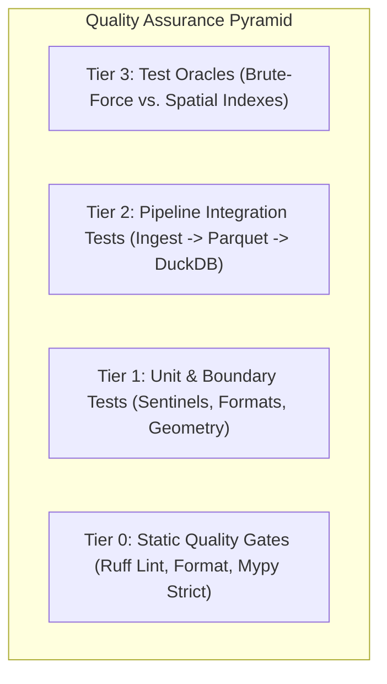

# Testing & Quality Assurance Strategy

> **Project AegisMar: Explainable Maritime Traffic Intelligence & Vessel Behavior Anomaly Detection Platform**

**Document Version:** 2.1  
**Status:** Approved Quality Assurance Standard  
**Test Framework:** Pytest 8.x / 9.x  
**Coverage Target:** $\ge 85\%$ Branch Coverage on Analytical Core  

---

## 1. Quality Assurance Philosophy

Project AegisMar is both an undergraduate academic research initiative and a software engineering portfolio. Testing is not an afterthought; it is the foundational mechanism that guarantees **scientific reproducibility** and **mathematical correctness**.

Every claim made in research reports regarding algorithmic accuracy, spatial completeness, and anomaly sensitivity must be backed by reproducible automated tests.

---

## 2. Multi-Tier Testing Architecture

### Tier 0: Static Analysis & Type Checking
- **Ruff**: Executed as both linter and code formatter. Enforces PEP 8, import sorting (`isort`), code modernization (`pyupgrade`), and flake8 bug detection (`flake8-bugbear`).
- **Mypy**: Enforced in strict mode (`--strict`). Zero untyped definitions, implicit optionals, or unchecked decorators permitted in `src/aegismar`.

### Tier 1: Unit & Boundary Testing
- Focuses on individual pure functions and isolated classes:
  - **AIS Sentinel Masking**: Tests all edge cases of ITU sentinels (`SOG==102.3`, `HDG==511`, `Status==15`, null island `(0,0)`, out-of-bounds coordinates).
  - **Geodesic Distance Accuracy**: Compares Haversine calculations against known international landmark coordinates and ellipsoidal benchmarks.
  - **Temporal Deltas & Kinematics**: Verifies implied velocity and turn-rate calculations between sequential timestamps.

### Tier 2: Pipeline Integration Testing
- Validates data transformation across subsystem boundaries:
  - **Parquet Round-Trip**: Verifies schema fidelity, column types, and null handling between Python dataclasses and Parquet disk storage.
  - **DuckDB SQL Aggregation**: Verifies that analytical queries return identical results to in-memory PyArrow computations.
  - **FastAPI Endpoints**: Uses `httpx.AsyncClient` / `TestClient` to test HTTP status codes, GeoJSON response structures, and read-only query parameters.

### Tier 3: Independent Test Oracles
- Algorithmic correctness is verified against an **independent test oracle**:
  - An exact, unaccelerated $O(N^2)$ brute-force geodesic-temporal comparator (`aegismar.spatial.oracle.BruteForceNeighborhoodOracle`, implemented in W2-01 with a safety guard at $N \le 5{,}000$) serves as the ground truth.
  - `BallTreeNeighborhoodProvider` is verified in automated tests (`tests/unit/test_oracle.py`, `tests/unit/test_st_dbscan.py`) against the oracle across 16 critical fixtures (isolated points, multi-cluster, exact spatial/temporal thresholds, core/border/noise, ambiguous multi-cluster borders, dateline crossing, high latitudes, randomized coastal sets, row permutation invariance, and quality-filtered conflicts) with zero missing or extra neighbors and 100% identical labels.
  - In Week 3, `H3NeighborhoodProvider` will be verified against the exact same oracle and BallTree reference, adding H3 cell-boundary ($\delta \le 10\text{ m}$) and pentagon tests.

---

## 3. Test Fixtures & Synthetic Data Policy

To comply with the rule that raw AIS datasets must never be committed to Git:
1. **No External Network Calls in Tests**: Test runs must execute entirely offline without fetching external URLs or datasets.
2. **Deterministic Synthetic Generators**: Tests utilize programmatic fixtures (in `tests/conftest.py` and `tests/fixtures/`) that generate parameterized vessel trajectories (e.g., straight-line transit, circular loitering, anchored dwell, sudden speed jump, transponder dropout).
3. **Committed Sample Fixtures**: Small, anonymized CSV/GeoJSON test files ($\le 500\text{ KB}$) may be committed under `data/samples/` or `tests/fixtures/` strictly for deterministic integration testing.

---

## 4. Verification Execution Commands

| Verification Step | Command | Acceptance Standard |
|---|---|---|
| **Static Linting** | `uv run ruff check .` | 0 errors, 0 warnings |
| **Code Formatting** | `uv run ruff format --check .` | 100% compliant, 0 re-formats needed |
| **Type Safety** | `uv run mypy src tests` | 0 type errors in strict mode |
| **Test Suite** | `uv run pytest -v` | 100% passing |
| **Coverage Analysis** | `uv run pytest --cov=aegismar --cov-report=term-missing` | $\ge 80\%$ ($\ge 85\%$ target) core coverage |
| **Full Quality Gate** | `uv run ruff check . && uv run ruff format --check . && uv run mypy src tests && uv run pytest -v` | All checks pass |

