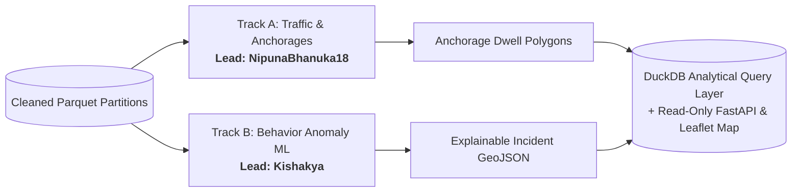

# Project AegisMar — START HERE

> **Explainable Maritime Traffic Intelligence & Vessel Behavior Anomaly Detection Platform**  
> **Collaborative AI Research & Software Engineering Knowledge Base**  
> **Repository:** [https://github.com/NipunaBhanuka18/Project-AegisMar](https://github.com/NipunaBhanuka18/Project-AegisMar)  
> **Primary Researchers:** NipunaBhanuka18 (Project Lead & Author) & Kishakya (ML Research Collaborator & Track B Lead)  
> **Date:** 2026-11-22 (status updated 2026-11-28: Week 3 complete)  

---

Welcome to **Project AegisMar**! This guide is the primary starting point for researchers, engineering contributors, and evaluators cloning or reviewing the repository. It explains what the project does, why it is architected this way, what has been mathematically verified, what evidence supports each claim, and how to begin contributing.

---

## 1. What is Project AegisMar?

**Project AegisMar** is an undergraduate AI research and software engineering initiative building an open-source, reproducible maritime telemetry analytics platform.

The project investigates two complementary computational and behavioral challenges in maritime domain awareness:
1. **Computational Acceleration of Spatiotemporal Clustering (Track A)**: Evaluating whether discrete hexagonal spatial partitioning (Uber H3) can accelerate Spatiotemporal DBSCAN (ST-DBSCAN) candidate generation while strictly preserving 100% spatial neighbor recall against a geodesic Haversine BallTree baseline.
2. **Explainable Vessel Behavior Anomaly Detection (Track B)**: Developing a trajectory-aware kinematic feature engineering and unsupervised anomaly detection subsystem (rule-based scoring and Isolation Forest / LOF) that provides human-interpretable physical factor explanations for alerts, distinguishing benign operational dwell from abnormal maneuvers.

---

## 2. The Real Maritime Business and Operational Problem

Over 80% of global commercial merchandise travels by sea. Modern coastal surveillance and port operations depend on the **Automatic Identification System (AIS)**—a VHF radio broadcast system mandated by the International Maritime Organization (IMO) that transmits real-time vessel identifiers, positions, speeds, courses, and operational statuses.

In high-density waterways like San Pedro Bay (Port of Los Angeles and Port of Long Beach), thousands of messages are broadcast every minute. Port authorities, coast guards, and maritime analysts face severe analytical bottlenecks:
- **Spatial Outliers $\neq$ Behavioral Threats**: Standard density-based clustering algorithms (like DBSCAN) treat isolated, low-density points as "noise." However, an isolated merchant ship peacefully cruising in an offshore traffic lane is normal, whereas a vessel exhibiting abrupt speed drops or sharp heading disparities inside an entrance channel represents a potential navigational hazard requiring operator review.
- **Port Dwell vs. True Anchorage Congestion**: In traditional ping-density heatmaps, a single tugboat broadcasting every 2 seconds produces 90× more spatial pings than a container ship broadcasting every 3 minutes. This creates massive sampling-frequency bias, making docks appear congested while obscuring true vessel dwell times in offshore commercial anchorages.
- **Black-Box Alert Fatigue**: Many machine learning anomaly models output opaque scalar risk scores (e.g., $P(\text{anomaly}) = 0.94$). When an alert fires, port operators cannot determine whether it was triggered by GPS antenna shielding near port cranes, strong tidal drift, or actual vessel distress. As documented in maritime operational literature on alert fatigue, unexplainable alarm systems risk being disregarded by operators.

---

## 3. Why Historical AIS Data Is Useful

AegisMar uses **historical daily AIS extracts** (specifically from NOAA Marine Cadastre) rather than live streaming feeds for its core research phase:
- **Scientific Reproducibility**: Historical batches are immutable. Any researcher can download the exact same 24-hour extract, verify its cryptographic hash (SHA-256), and reproduce data processing and benchmark results deterministically within defined numerical tolerances on the tested Python 3.11 environment (subject to standard cross-platform floating-point precision tolerances).
- **Authentic Sensor Noise**: Real NOAA AIS telemetry contains authentic GPS jitter, sensor nulls, duplicate broadcasts, and sentinel codes (e.g. SOG of 102.3 kt, Heading 511°).
- **Offline Local Execution**: The entire research pipeline runs deterministically on standard local storage without requiring internet connections, cloud accounts, or third-party streaming API credentials.

---

## 4. What AIS Data Can and Cannot Establish

To prevent unscientific claims or misleading terminology in our papers and documentation, we enforce strict domain boundaries:

| Observation in AIS | What It CAN Establish | What It CANNOT Establish |
|---|---|---|
| **Prolonged Broadcast Gap ($\Delta t > 30\text{ min}$)** | A signal reception gap occurred within the terrestrial receiving station network (no valid packet was recorded for the vessel during that period). | That the vessel's transponder was deactivated or suffered hardware failure, or that the crew acted with illicit or clandestine intent (terrestrial gaps frequently arise from antenna shadowing near port gantry cranes, VHF packet collisions in high-density waterways, or terrain occlusion). |
| **Course-Heading Disparity ($|\text{COG} - \text{HDG}| > 45^\circ$)** | The vessel's direction of movement deviates from its bow orientation (crabbing or drifting). | Malicious intent (crabbing is standard maritime behavior when counteracting strong cross-winds or tidal currents, and gyrocompasses drift at low speeds $<1.5\text{ kt}$). |
| **Same-Timestamp Position Conflict** | Two different GPS coordinates were broadcast at the identical second for one MMSI. | Which coordinate was genuine without external radar or satellite verification; both are retained with `TIMESTAMP_POSITION_CONFLICT`. |
| **ST-DBSCAN Density Cluster** | Points are spatiotemporally co-located within 300 m and 900 s. | That the cluster is an official anchorage (it may be a terminal berth, a dredged channel, or a slow-traffic fairway). |
| **Isolation Forest Score** | The relative mathematical isolation of a trajectory window in normalized feature space. | A calibrated Bayesian probability of illegal activity or physical distress. |

---

## 5. What the Proposed Final Product Does

When fully assembled, Project AegisMar delivers an offline-first analytical platform:
1. **Batch Ingestion Engine**: Converts raw AIS CSV files into standardized, quality-flagged, zstd-compressed Parquet tables with cryptographic manifests.
2. **Dual Clustering Engine**: Executes ST-DBSCAN via either reference Haversine BallTree or accelerated Uber H3 candidate generation.
3. **Anchorage & Dwell Intelligence**: Extracts vessel stay-points ($\Delta D_{\text{max}} \le 500\text{ m}$ for $\Delta T_{\text{min}} \ge 30\text{ min}$), clips out terminal berths using official port GIS polygons, and aggregates unique vessel waiting times (`count(distinct MMSI)`).
4. **Trajectory Anomaly Engine**: Identifies physical velocity discontinuities, abnormal drifting, and dark transponder gaps, emitting explainable incident JSON records with factor decompositions.
5. **Read-Only FastAPI & Map Inspector**: Serves precomputed GeoJSON layers to an interactive Leaflet browser dashboard running locally on `localhost:8000`.

---

## 6. How the Platform's Two Research Tracks Complement One Another

Project AegisMar is organized as **one unified research and engineering initiative** with two complementary technical workstreams:



- **Track A (Geospatial Clustering Lead: NipunaBhanuka18)**: Owns spatial indexing, ST-DBSCAN clustering, H3 optimization benchmarks, stay-point extraction, and anchorage utilization.
- **Track B (Vessel Behavior ML Lead: Kishakya)**: Owns vessel trajectory feature engineering, explainable rule-based scoring, unsupervised anomaly models (Isolation Forest / LOF), and perturbation evaluation.
- **Integration**: Both tracks consume the identical cleaned Parquet dataset and feed their precomputed outputs into a shared DuckDB storage layer and read-only map interface.

---

## 7. Why This Architecture Was Selected

AegisMar is built as a **Python-first modular monolith** backed by in-process columnar storage (Apache Parquet + DuckDB).

### Why not microservices, Docker, Kafka, or PostGIS?
- **Serialization Overhead**: Sending 143k+ spatial observations over TCP sockets between microservices incurs substantial serialization and IPC overhead (JSON/gRPC marshalling) compared to shared in-memory Arrow buffers.
- **Infrastructure Drag**: Managing Docker daemons, Kubernetes, PostgreSQL servers, and Kafka message queues would consume dozens of hours on devops plumbing instead of mathematical and scientific research.
- **Reproducibility**: Any student or academic evaluator can clone the repository, run `uv sync --locked`, and immediately run the entire test suite and pipeline without setting up database servers or network mappings.

For the detailed architectural decisions and trade-offs, read our [Architecture Decision Records (ADRs)](02-architecture/decisions/README.md).

---

## 8. What Has Already Been Implemented

The repository has completed foundational data engineering and reference clustering milestones:
- **Milestone W1-01**: Clean Python 3.11.9 repository skeleton, `uv` packaging, strict `.gitignore`, complete documentation hierarchy.
- **Milestone W1-02A**: NOAA 2025 AIS schema investigation, San Pedro Bay (Los Angeles / Long Beach) study region selection (143,156 raw pings, 362 vessels).
- **Milestone W1-02B**: Production AIS ingestion pipeline (`aegismar ingest`), dual-format schema adapter (NOAA 2025 + legacy), sentinel nullification, duplicate consolidation, and columnar `zstd` Parquet storage.
- **Milestone W2-01**: Ingestion hardening (strict integer MMSI sanitation, same-timestamp conflict preservation, ambiguous header rejection), reference Haversine `BallTree` ST-DBSCAN engine (`stdbscan-core-first-v1.0`), and independent brute-force $O(N^2)$ oracle (`BruteForceNeighborhoodOracle`). 52 automated tests passing with 95% total code coverage.
- **Milestone W2-CLOSE**: Public exploratory clustering visualization published in `README.md` (`docs/assets/w2-balltree-clustering.png`).
- **Milestone W3-01**: Uber H3 discrete hexagonal candidate neighborhood provider (`H3NeighborhoodProvider`) with safe $k$-ring coverage lower bounds, exact Haversine/temporal pruning, and pentagon fallback. Verified 100% recall (0 missing neighbors) against the brute-force oracle and 100% role/label identity with BallTree across 143,116 real LA/LB observations. 77 automated tests passing with 93% total code coverage.
- **Milestone W3-01A / W3-01B**: H3 Option B correctness contract (calibrated resolutions 7–9, fail-closed BallTree fallback) and the `aegismar verify-parity` command.
- **Milestone W3-02A**: Dataset provenance in `manifest.json` and the versioned logical content fingerprint (`aegismar-logical-v1`, `aegismar fingerprint`) ([ADR-011](02-architecture/decisions/ADR-011-dataset-provenance-and-content-fingerprinting.md)). The canonical v1.1 dataset lives in `data/processed/lalb_20250101_v1_1/`.
- **Milestone W3-02**: Locked comparative benchmark of BallTree vs. H3 at resolutions 7, 8 and 9 across 10k / 50k / 100k / full ([protocol](03-research/w3-02-benchmark-protocol.md), [results](03-research/w3-02-benchmark-results.md)).
- **Track B ML-01 (in progress) / ML-02 / ML-03 / ML-04 (completed)**:
  - Reproducible dataset profiling (`experiments/anomaly/ml01_profile_dataset.py`) and drift breakdown (`experiments/anomaly/ml02_drift_breakdown.py`).
  - Accepted feature specification ([ML-02](03-research/ml-02-feature-spec.md)) and frozen evaluation protocol ([ML-03](03-research/ml-03-evaluation-protocol.md)).
  - ML-04 trajectory feature extractor (`src/aegismar/anomaly/`, PR #6).
  - NOAA bounding-box slicer (`scripts/slice_noaa_bbox.py`), which reproduces the documented 2025-01-01 sample exactly.
  - No anomaly models are merged yet.
- **Test suite (2026-11-28)**: 183 tests with 96% coverage, enforced by GitHub Actions CI (coverage ≥ 85%).

---

## 9. What Has Actually Been Tested and Measured

To ensure absolute transparency, our current measurements are categorized according to the [Research Evidence Register](03-research/evidence-register.md):

1. **Automated Software Correctness**:
   - 183 automated unit, oracle, benchmark-harness and CLI regression tests pass, with 96% coverage (2026-11-28). They run locally and in GitHub Actions CI.
   - Both the reference `BallTreeNeighborhoodProvider` and `H3NeighborhoodProvider` match the independent brute-force oracle 100% (zero missing, zero extra neighbors) on synthetic fixtures, dateline crossings, polar coordinates, pentagonal cells, and randomized distributions.
2. **Exploratory Real-Data Baseline (Single Workstation Run on LA/LB)**:
   - Input: 143,124 cleaned rows -> 8 position conflicts excluded -> **143,116 analyzed observations**.
   - Output: **241 spatiotemporal density clusters** (136,276 core, 934 border, 5,906 noise).
   - Accounting check: $136{,}276 + 934 + 5{,}906 = 143{,}116$ (exact match).
   - **BallTree Parity**: `H3NeighborhoodProvider` matches `BallTreeNeighborhoodProvider` across all 143,116 observations with 100.0% label match and 100.0% role match on identical inputs.
   - Recorded uninstrumented BallTree wall time (reported in development log): **13.680 seconds** (0.077 s build, 13.341 s query, 0.262 s clustering).
   - Recorded instrumented BallTree run under `tracemalloc` (persisted in `w2_01_lalb_balltree/clustering_summary.json`): **38.014 seconds** total wall time (0.083 s build, 31.348 s query, 6.583 s clustering) with **225.83 MB peak heap memory**.
   - Recorded instrumented H3 run under `tracemalloc` (persisted in `w3_01_lalb_h3/clustering_summary.json`): **55.668 seconds** total wall time (0.984 s build, 46.343 s query, 8.342 s clustering) with **233.82 MB peak heap memory** (798 occupied cells, 0 fallbacks).
   - *Note*: These are single recorded exploratory workstation runs.
3. **Formal Multi-Trial Benchmark (W3-02, 2026-11-28, canonical v1.1, commit `379ec16`)**:
   - Exact parity of H3 at resolutions 7, 8 and 9 with BallTree at 10k, 50k, 100k and full scale: recall = precision = ARI = 1.0, 0 fallbacks.
   - Uninstrumented totals at full scale (mean of 10 counterbalanced trials): BallTree 12.4074 s vs. H3 r8 10.7867 s, a 1.150× speedup.
   - H3 r8 is slower below 100k and at parity at 100k. r7 and r9 are slower than BallTree at all tested scales.
   - These are single-host descriptive statistics: see [w3-02-benchmark-results.md](03-research/w3-02-benchmark-results.md).

---

## 10. What Research Questions Remain Unanswered

The following core research questions are currently under active investigation:
- **RQ1 (Track A)**: *(Answered for one host and dataset by W3-02.)* H3 r8 preserves exact parity and is 1.15× faster than BallTree at 143k rows, but slower below 100k. Still open:
  - whether the crossover holds on other hardware, denser multi-day inputs and the deferred 500k scale;
  - how it changes with other ε settings.
- **Stay-Point Identification (Track A)**: What displacement and duration thresholds ($\Delta D_{\text{max}}, \Delta T_{\text{min}}$) accurately isolate vessels at anchor outside the San Pedro breakwater while excluding maneuvering vessels?
- **RQ2 (Track B)**: Can trajectory-derived kinematic feature vectors distinguish abnormal maneuvers from normal navigation with lower false alarms than spatial density noise baselines?
- **Model Explainability (Track B)**: Does an unsupervised Isolation Forest or LOF model provide superior PR-AUC ranking on held-out vessel trajectories compared to a rule-based kinematic scorer while maintaining transparent factor attribution?

---

## 11. How to Reproduce the Current Baseline

You can reproduce our cleaned data and reference clustering run in under 2 minutes:

```powershell
# 1. Clone repository and install locked dependencies
git clone https://github.com/NipunaBhanuka18/Project-AegisMar.git
cd Project-AegisMar
uv sync --locked

# 2. Run quality gates (all tests should pass; 183 as of 2026-11-28; same gates as CI)
uv run pytest --cov=aegismar --cov-fail-under=85 -v
uv run ruff check .
uv run ruff format --check .
uv run mypy src tests

# 3. Ingest the San Pedro Bay regional CSV into the canonical v1.1 Parquet.
#    Never pass --overwrite: lalb_20250101/ (v1.0) and lalb_20250101_v1_1/ (v1.1) are immutable.
#    Without --overwrite, ingestion refuses to replace an existing Parquet or manifest.
uv run python -m aegismar ingest `
  --input data/raw/sample_lalb_20250101.csv `
  --output data/processed/lalb_20250101_v1_1
uv run python -m aegismar fingerprint --input data/processed/lalb_20250101_v1_1/cleaned_ais.parquet

# 4. Run the reference Haversine BallTree ST-DBSCAN clustering engine
#    (--overwrite here only replaces git-ignored experiment outputs)
uv run python -m aegismar cluster `
  --input data/processed/lalb_20250101_v1_1/cleaned_ais.parquet `
  --output experiments/outputs/w2_01_lalb_balltree `
  --eps-spatial-m 300 `
  --eps-temporal-s 900 `
  --min-samples 5 `
  --overwrite

# 5. Run the verified H3-accelerated ST-DBSCAN clustering engine (W3-01)
uv run python -m aegismar cluster `
  --input data/processed/lalb_20250101_v1_1/cleaned_ais.parquet `
  --output experiments/outputs/w3_01_lalb_h3 `
  --provider h3 `
  --h3-resolution 8 `
  --eps-spatial-m 300 `
  --eps-temporal-s 900 `
  --min-samples 5 `
  --overwrite

# 6. Inspect the generated clustering summaries
Get-Content experiments/outputs/w2_01_lalb_balltree/clustering_summary.json
Get-Content experiments/outputs/w3_01_lalb_h3/clustering_summary.json

# 7. (Optional, about 38 min) Reproduce the W3-02 benchmark
uv run python experiments/clustering/w3_02_benchmark.py `
  -i data/processed/lalb_20250101_v1_1/cleaned_ais.parquet `
  -o experiments/outputs/w3_02_benchmark_results.json
```

---

## 12. Where to Find Code, Experiments, and Decisions

- **Source Code**: [`src/aegismar/`](../src/aegismar/)
  - `ingestion/`: CSV parsing, sentinel nullification, schema adapter, Parquet writer.
  - `spatial/`: Spherical Haversine functions and the isolated $O(N^2)$ brute-force test oracle.
  - `clustering/`: ST-DBSCAN core (`stdbscan-core-first-v1.0`), BallTree provider, H3 hexagonal candidate provider (`h3_neighbors.py`), configuration, and exporters.
  - `common/`: Constants, ITU sentinels, quality flags, and dataclasses.
- **Automated Tests**: [`tests/`](../tests/)
  - `unit/test_ingestion.py`: Schema mapping, duplicate consolidation, conflict flagging.
  - `unit/test_st_dbscan.py`: ST-DBSCAN fixtures, permutation invariance, boundary tie-breaking.
  - `unit/test_oracle.py`: Oracle vs. BallTree mathematical equivalence tests.
  - `unit/test_h3_neighbors.py`: H3 completeness and oracle parity fixture tests (32 fixture categories).
  - `unit/test_provenance.py`: Logical content fingerprint and canonical-order verification (W3-02A).
  - `unit/test_benchmark.py`: W3-02 benchmark harness (timing invariance, statistics, counterbalancing, end-to-end mini benchmark).
- **Architecture Decisions**: [`docs/02-architecture/decisions/`](02-architecture/decisions/) (ADRs 001 through 011).
- **Research Documentation**: [`docs/03-research/`](03-research/)
  - `evidence-register.md`: The official verification and claims register.
  - `research-plan.md`: Formal research questions and hypotheses.
  - `evaluation-protocol.md`: Scientific benchmark methodology.
  - `w3-02-benchmark-protocol.md` / `w3-02-benchmark-results.md`: Locked W3-02 protocol and executed results.
  - `vessel-behavior-ml.md`: The ML anomaly detection research proposal.
  - `ml-02-feature-spec.md`: Accepted Track B feature specification (v1.0).
  - `ml-03-evaluation-protocol.md`: Frozen Track B evaluation protocol (v1.0).
- **Track B Experiment Scripts**: [`experiments/anomaly/`](../experiments/anomaly/) (profiling and analysis scripts; outputs are written to the gitignored `experiments/outputs/anomaly/`).
- **Data Tooling**: [`scripts/slice_noaa_bbox.py`](../scripts/slice_noaa_bbox.py) (stream-decompresses a NOAA `.csv.zst` daily extract and slices the study bounding box).

---

## 13. Practical Collaborator Onboarding Checklist

First-time contributors, academic evaluators, and research collaborators can follow this step-by-step 11-point workflow to get fully onboarded:

1. **Clone the Repository**:
   ```bash
   git clone https://github.com/NipunaBhanuka18/Project-AegisMar.git
   cd Project-AegisMar
   ```
2. **Install the Locked Environment**:
   Ensure Python 3.11.9 is available and synchronize dependencies:
   ```bash
   uv sync --locked
   ```
3. **Execute Local Quality Gates**:
   Run the full suite of automated unit, oracle, linting, formatting, and strict type tests:
   ```powershell
   uv run pytest -v
   uv run ruff check .
   uv run ruff format --check .
   uv run mypy src tests
   ```
4. **Reproduce or Obtain Permitted AIS Telemetry**:
   Generate canonical Parquet storage from the regional San Pedro Bay sample without committing data:
   ```powershell
   uv run python -m aegismar ingest --input data/raw/sample_lalb_20250101.csv --output data/processed/lalb_20250101_v1_1
   ```
   *(For full-day NOAA downloads, follow instructions in [docs/05-guides/ml-research-onboarding.md](05-guides/ml-research-onboarding.md#6-how-to-acquire-or-reproduce-permitted-research-data)).*
5. **Understand the Existing Implementation**:
   Familiarize yourself with established modules under [`src/aegismar/`](../src/aegismar/):
   - `ingestion/`: Schema adapters and Parquet writers.
   - `spatial/`: Spherical Haversine metric and $O(N^2)$ brute-force test oracle.
   - `clustering/`: Core-first ST-DBSCAN (`stdbscan-core-first-v1.0`), BallTree neighborhood provider, and preview exporters.
   - `common/`: Canonical types, ITU sentinels, and quality flags.
6. **Read Key Architecture Decision Records**:
   Review [ADR-001 (Modular Monolith)](02-architecture/decisions/ADR-001-modular-monolith.md), [ADR-007 (Core-First ST-DBSCAN)](02-architecture/decisions/ADR-007-deterministic-core-first-st-dbscan.md), and [ADR-010 (Collaborative Workstream)](02-architecture/decisions/ADR-010-separate-integrated-behavioral-ml-workstream.md).
7. **Distinguish Implemented Features from Planned Work**:
   Consult the [Research Evidence Register](03-research/evidence-register.md) to verify what has been formally measured versus what remains a planned hypothesis.
8. **Review the ML Research Proposal**:
   If contributing to behavioral analytics (Track B), review the [ML Research Proposal](03-research/vessel-behavior-ml.md), the accepted [ML-02 Feature Specification](03-research/ml-02-feature-spec.md) and [ML-03 Evaluation Protocol](03-research/ml-03-evaluation-protocol.md), and the detailed [ML Onboarding Guide](05-guides/ml-research-onboarding.md).
9. **Create an Isolated Development Branch**:
   ```bash
   git checkout main
   git pull origin main
   git checkout -b feat/ml-trajectory-features
   ```
10. **Use Coding Assistants Responsibly**:
    Adhere to academic integrity rules: never accept simulated or synthetic benchmark metrics from AI assistants, manually verify mathematical formulations, and inspect `git status` prior to staging.
11. **Submit a Pull Request**:
    Review [CONTRIBUTING.md](../CONTRIBUTING.md) and fill out the pull request checklist in [`.github/pull_request_template.md`](../.github/pull_request_template.md). Verify all quality gates pass locally before requesting review.

---

## 14. Next Research Milestones

- **Track A (Maritime Traffic & Clustering — Lead: NipunaBhanuka18)**:
  - **Milestone W3-01**: *(Completed)* Implemented Uber H3 hexagonal candidate neighborhood provider (`H3NeighborhoodProvider`) and verified 100% neighbor recall against oracle and BallTree reference.
  - **Milestone W3-02A / W3-02**: *(Completed)* Dataset provenance and fingerprinting; comparative H1 benchmarks (BallTree vs. H3) across 10k, 50k, 100k and full LA/LB ([results](03-research/w3-02-benchmark-results.md)).
  - **Milestone W4-01 / W4-02** *(next)*: Stay-point extraction, berth polygon exclusion, and anchorage dwell analytics.
  - **Milestone W5-01 / W6-01**: DuckDB analytical storage, `vessel_anomaly_v1` contract integration, and read-only FastAPI service.
  - **Milestone W7-01 / W8-01**: Interactive geospatial web dashboard and multi-trial benchmark reproducibility package.
- **Track B (Vessel Behavior ML & Anomaly Detection — Lead: Kishakya)**:
  - **Milestone ML-01**: *(In progress — data profiling completed; literature review pending)* Review domain literature, AIS telemetry fields, and evaluation constraints.
  - **Milestone ML-02**: *(Completed — [v1.0](03-research/ml-02-feature-spec.md))* Mathematical specifications for trajectory windowing and kinematic features.
  - **Milestone ML-03**: *(Completed — [v1.0](03-research/ml-03-evaluation-protocol.md), frozen)* Baseline models and synthetic perturbation evaluation protocol.
  - **Milestone ML-04**: *(Completed — PR #6)* Implement `features.py` per ML-02 and the first reproducible feature engineering experiment on the development day.
  - **Milestone ML-05**: Anomaly model evaluation and `vessel_anomaly_v1` GeoJSON contract export.
